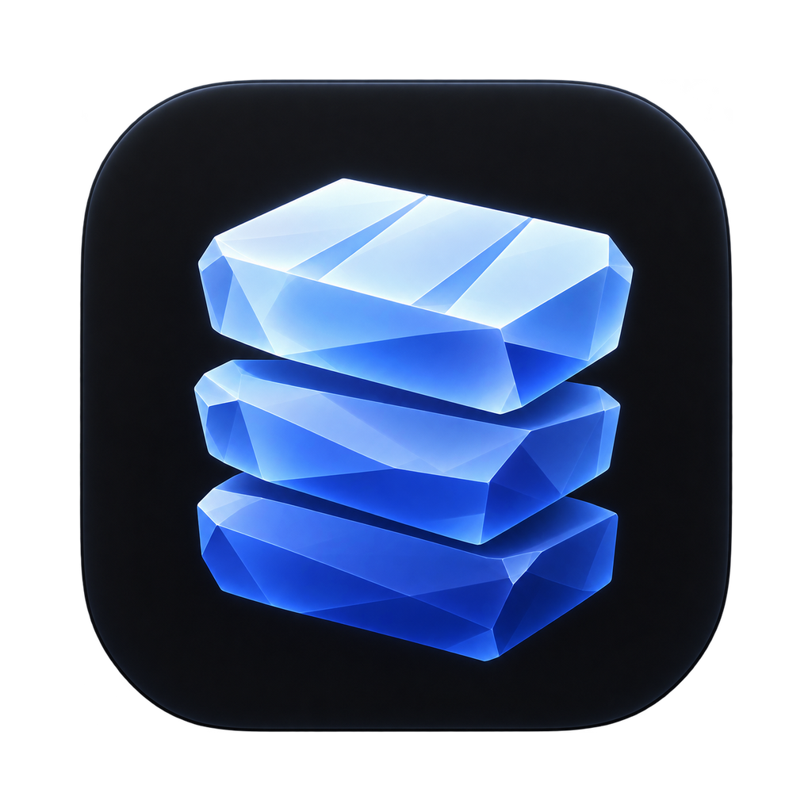

# TableCraft

**A desktop database IDE in the spirit of JetBrains DataGrip**

Connections, a database explorer, SQL consoles with schema-aware completion, a result grid, a table
data editor, DDL and SQL generation, query history and EXPLAIN plans. Databases are reached through
[datasource plugins](#supported-databases) loaded at runtime.

**[Releases](https://github.com/tranphucbol/table-craft/releases)** ·
**[Documentation](#documentation)** ·
**[Contributing](CONTRIBUTING.md)** ·
**[Report a bug](https://github.com/tranphucbol/table-craft/issues/new)**

[Supported databases](#supported-databases) · [Highlights](#highlights) · [Install](#install) ·
[Quick start](#quick-start) · [How it works](#how-it-works) · [Agents](docs/guide/agents.md) ·
[License](#license)

https://github.com/user-attachments/assets/9aec53fe-6fcd-40dc-ab79-4fe0cacb6dc4

## Supported databases

| Database                       | Plugin                                                                                                                                                        | Since                                                                      |
| ------------------------------ | ------------------------------------------------------------------------------------------------------------------------------------------------------------- | -------------------------------------------------------------------------- |
| SQLite                         | In the box                                                                                                                                                    | [v0.1.0](https://github.com/tranphucbol/table-craft/releases/tag/v0.1.0)   |
| MySQL, MariaDB, TiDB           | In the box                                                                                                                                                    | [v0.1.0](https://github.com/tranphucbol/table-craft/releases/tag/v0.1.0)   |
| PostgreSQL                     |                | [v0.1.0](https://github.com/tranphucbol/table-craft/releases/tag/v0.1.0)   |
| [Redis](docs/guide/redis.md)   |                      | [v1.3.0](https://github.com/tranphucbol/table-craft/releases/tag/v1.3.0)   |
| [Oracle](docs/guide/oracle.md) |                    | [v1.11.0](https://github.com/tranphucbol/table-craft/releases/tag/v1.11.0) |
| SQL Server, Azure SQL          |                      | [v1.11.0](https://github.com/tranphucbol/table-craft/releases/tag/v1.11.0) |
| [etcd](docs/guide/etcd.md)     |                        | [v1.18.0](https://github.com/tranphucbol/table-craft/releases/tag/v1.18.0) |
| [DuckDB](docs/guide/duckdb.md) |  | [v1.28.0](https://github.com/tranphucbol/table-craft/releases/tag/v1.28.0) |

In the box means the plugin ships inside the app and works offline; the others download from npm the
first time you add such a data source ([Plugins](docs/guide/plugins.md)).

## Highlights

- [DataGrip's keymap and layout](docs/guide/shortcuts.md#search-everywhere): tool windows, `⇧⇧` Search Everywhere, `⇧⌘A`
  Find Action, and the chords your hands already know.
- [Import your connections](docs/guide/connections.md#import-from-datagrip-tablepro-mysql-workbench-or-beekeeper-studio):
  from DataGrip, TablePro, MySQL Workbench or Beekeeper Studio, with SSH tunnels, folders and colours.
- [An MCP server for AI agents](docs/guide/agents.md): Claude Code, OpenCode or Cursor list schemas and run
  queries; each data source starts off, and writes wait for your approval.
- [Completion that knows your schema](docs/guide/completion.md): tables after `FROM`, whole join
  conditions after `JOIN`, and the columns of an alias after `o.`.
- [A table editor that shows its SQL](docs/guide/data.md#table-data-editor): edit cells, add and delete rows, preview
  the statements, and submit them in one transaction.
- [An ER diagram that guesses missing keys](docs/guide/explorer.md#er-diagram): a schema's tables and keys, with the
  `customer_id` columns a database never declared drawn dashed; hide a wrong guess, add a missed one.
- [Explain Plan as a tree](docs/guide/console.md#explain): estimated and actual rows, costs and timings; Explain Analyse
  asks before it runs a write.
- [Query history and a Services tree](docs/guide/monitoring.md#query-history-and-services): every statement you ran, per
  data source, with its outcome, row count and duration.
- [Large results stay responsive](docs/guide/data.md#result-grid): rows stay in the engine process and the grid reads
  windows of them, so a million-row result does not freeze the window.
- [Themes, fonts and density](docs/guide/settings.md): Dark, Light, High contrast, 43
  [ported themes](docs/guide/themes.md) such as Gruvbox, Nord and Solarized, or your own theme file, three font
  roles, and a compact layout.
- [Redis, standalone and Cluster](docs/guide/redis.md): a key tree that scans instead of blocking, typed key
  tabs with guarded edits, a `redis-cli` console with completion from the server, and a Server tab.
- [etcd, from keys to cluster](docs/guide/etcd.md): guarded key editing with history and merge,
  leases, live Watch, members and maintenance, users and roles, and a visual transaction builder.
- [Oracle without the Instant Client](docs/guide/oracle.md): schemas, packages and their members in the tree,
  `DBMS_OUTPUT` in Output, every SQL function of the manual in completion, sessions and plans.
- [Plugins for any database](docs/guide/plugins.md): PostgreSQL, MySQL, SQLite, Oracle and SQL Server are
  plugins, loaded the same way yours would be. SQLite and MySQL come in the box; PostgreSQL, Oracle,
  SQL Server, [DuckDB](docs/guide/duckdb.md) (Parquet and `csv.zst` files too), Redis and etcd
  download the first time you need them.

## Install

Download the latest build for your platform below, or pick any version on the
[Releases](https://github.com/tranphucbol/table-craft/releases) page. Once installed, TableCraft
[updates itself](docs/guide/install.md#updates).

| Platform              | Download                                                                                                                       |
| :-------------------- | :----------------------------------------------------------------------------------------------------------------------------- |
| macOS (Apple silicon) | [`TableCraft-arm64.dmg`](https://github.com/tranphucbol/table-craft/releases/latest/download/TableCraft-arm64.dmg)             |
| macOS (Intel)         | [`TableCraft-x64.dmg`](https://github.com/tranphucbol/table-craft/releases/latest/download/TableCraft-x64.dmg)                 |
| Windows x64           | [`TableCraft-x64.exe`](https://github.com/tranphucbol/table-craft/releases/latest/download/TableCraft-x64.exe)                 |
| Linux x64             | [`TableCraft-x86_64.AppImage`](https://github.com/tranphucbol/table-craft/releases/latest/download/TableCraft-x86_64.AppImage) |

The builds are not signed with a paid certificate, so the first launch needs one extra step:

- **macOS**: see [Running the unsigned macOS app](docs/guide/install.md#running-the-unsigned-macos-app).
- **Windows**: SmartScreen says _Windows protected your PC_; click **More info**, then **Run
  anyway**.
- **Linux**: make the AppImage executable with `chmod +x TableCraft-*.AppImage` and run it.

## Quick start

1. Press `⌘N` (`Ctrl+N`) in the Database pane, or pick **New Data Source…** from the data source
   widget in the toolbar, and choose PostgreSQL, MySQL, SQLite or Oracle. PostgreSQL and Oracle
   show **Download** the first time: TableCraft fetches the plugin, then opens the form
   ([Databases in the box and on demand](docs/guide/plugins.md#databases-in-the-box-and-on-demand)).
2. Fill in the connection, click **Test Connection**, then **OK**. The data source appears in the
   Database tree.
3. Select it and press `⇧⌘L` (`Ctrl+Shift+L`) to open a console. Type a query and press `⌘↩`
   (`Ctrl+Enter`) to run the statement at the caret.
4. Select a table in the tree and press `F4` to open its data in the table editor.

## How it works

TableCraft runs three kinds of process. The main process owns windows, menus and saved settings,
and holds no database state. Each connected data source gets its own engine, an Electron utility
process that loads the plugin and runs the queries, so a slow or crashing driver takes down one data
source, not the app. The renderer is a pure view that talks to the engine over a `MessagePort`.
Result rows stay in the engine; the grid reads windows of them, and sorting, copying and exporting
happen there too. Everything a dialect knows about SQL, from splitting statements to completion and
EXPLAIN, lives in its plugin, and the built-in plugins load through the same runtime loader as user
plugins. The [specification](docs/design/specification.md) describes the whole of v1, and
[docs/decisions](docs/decisions/) records why it is built this way.

## Documentation

**Using TableCraft**

- [Install](docs/guide/install.md): the installers, opening the unsigned macOS app, updates, and
  building from source.
- [Connections](docs/guide/connections.md): data sources, SSH tunnels, SSL, and importing them from
  DataGrip, TablePro, MySQL Workbench or Beekeeper Studio.
- [Database explorer](docs/guide/explorer.md): the tree, DDL and SQL generation, the ER diagram,
  and running a routine.
- [SQL console](docs/guide/console.md): running statements, transactions, inspections and Explain.
- [Completion and navigation](docs/guide/completion.md): schema-aware completion, navigation and
  snippets.
- [Results and table data](docs/guide/data.md): the result grid, the table data editor and import.
- [History, sessions and the log](docs/guide/monitoring.md): query history, the Services tree,
  server sessions and the app log.
- [Agents (MCP)](docs/guide/agents.md): letting an AI agent query your data sources.
- [Where your data lives](docs/guide/data-and-privacy.md): the profile folder, passwords, and what
  TableCraft sends over the network.

**Databases**

- [Plugins](docs/guide/plugins.md): which databases ship in the box and which download on demand.
- [Redis](docs/guide/redis.md): the key tree, key tabs, the command console and the Server tab.
- [etcd](docs/guide/etcd.md): revision-guarded keys, leases, Watch and cluster administration.
- [Oracle](docs/guide/oracle.md): connecting without the Instant Client, and what differs from SQL
  databases.
- [DuckDB](docs/guide/duckdb.md): database files, Parquet and CSV files, file locks and
  transactions.

**Customising**

- [Search Everywhere and shortcuts](docs/guide/shortcuts.md): Search Everywhere, Find Action and
  the keymap.
- [Settings and appearance](docs/guide/settings.md): the Settings dialog and every field of
  `settings.json`.
- [Themes](docs/guide/themes.md): the bundled themes and where they come from.

**Extending**

- [Writing plugins](docs/guide/writing-plugins.md): the manifest, capabilities, plugin API
  compatibility and the contract suite.

## Not in v1

- Later: ER diagrams, schema compare and migrations, XLSX and JSON import, a plugin marketplace, a MongoDB
  plugin, a CLI, AI assistance, Git integration, a debugger, notebooks, Docker and
  Kubernetes integration.

## Contributing

Bug reports and pull requests are welcome. [CONTRIBUTING.md](CONTRIBUTING.md) covers setting up,
which tests a change needs and the rules review checks; [AGENTS.md](AGENTS.md) is the full reference
for commands and conventions, and [RELEASING.md](RELEASING.md) is how a maintainer cuts a release.

## License

[MIT](LICENSE)

Database logos come from [Simple Icons](https://simpleicons.org) (CC0). The names and logos are
trademarks of their owners, shown only to say which database a data source is; their use implies
no endorsement.
