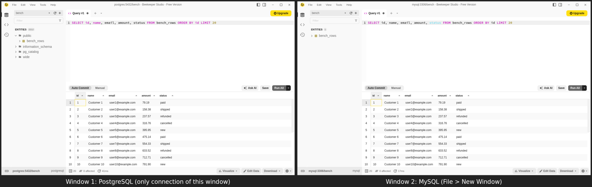
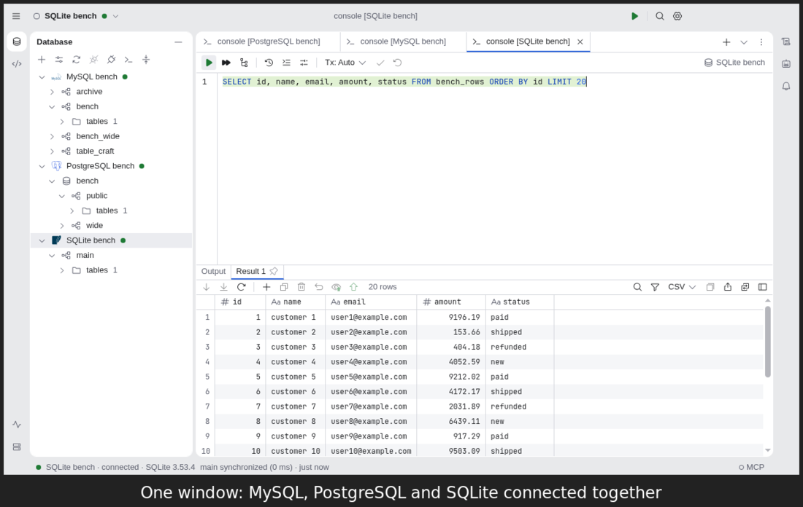

# TableCraft vs Beekeeper Studio: performance

A side-by-side benchmark of TableCraft and Beekeeper Studio on the same machine, databases and
data, run on 3–4 November 2026. It measures what a user waits for and what the app costs in memory:
start-up, query results from 10,000 to 1,000,000 rows, opening a large table, a schema with
2,000 tables, and a CSV export of 1,000,000 rows.

## Summary

- **TableCraft is faster at every step except expanding a big schema.** Cold start takes 0.4 s
  against 3.0 s, and query results appear in under 0.1 s against 0.4–3.9 s.
- **TableCraft's window never froze.** No load in TableCraft blocked its renderer's main thread for
  more than 50 ms. Beekeeper's blocked for 0.3–0.5 s on 10,000 rows, about 2 s on its default
  50,000-row cap and about 3.5 s on 100,000 rows, with single tasks up to 2.9 s.
- **TableCraft uses about 40% of Beekeeper's memory.** Idle, TableCraft uses 345 MB and Beekeeper
  867 MB. With 100,000 rows loaded, it is 755 MB against 2,157 MB.
- **Beekeeper cannot hold 1,000,000 rows.** With its row limit raised to 1,000,000, its renderer
  grows past 3.7 GB and crashes after 62–84 s, on PostgreSQL, MySQL and SQLite alike. TableCraft
  fetches all 1,000,000 rows in 1.4–2.4 s at about 1.1 GB for the whole app, and scrolls to the last
  row without a dropped frame.
- **TableCraft exports about 8 times faster.** A CSV of 1,000,000 rows takes 11 s in TableCraft and
  89–94 s in Beekeeper. Neither app's window blocks during the export.
- **Beekeeper expands a big schema faster.** It loads every table of every schema when it connects,
  so expanding the 2,000-table schema then takes 73 ms against TableCraft's 288 ms. The cost moves
  into Beekeeper's connect time instead, and finding one table by typing is still faster in
  TableCraft (113 ms against 542 ms).

## What was compared

|                      | TableCraft                                                 | Beekeeper Studio                                |
| :------------------- | :--------------------------------------------------------- | :---------------------------------------------- |
| Version              | `main` at `63bc95da` (4 Nov 2026), development build       | 6.2.0 Community, arm64 `.deb` release           |
| Electron             | 43.4                                                       | 44.9.1                                          |
| Where rows live      | engine utility process; the renderer sees a window of rows | renderer (Vue state and Tabulator)              |
| Query result default | one page of 500 rows, cursor kept open, more on scroll     | the whole result, truncated to 50,000 rows      |
| Table view default   | 500 rows per page                                          | 100 rows per page, server-side `LIMIT`/`OFFSET` |

## Environment

- **Machine:** Apple M4 (10 cores, 16 GB), macOS 27.0.
- **Where the apps ran:** both apps ran in TableCraft's headless test box, a Linux arm64 container
  under Xvfb (decision 063), inside a Docker VM with 8 GB of memory and 10 CPUs. The numbers are
  therefore Linux numbers.
- **Database servers:** PostgreSQL 17 and MySQL 8.4 ran from `test/db/compose.yml` on the same Docker
  network. SQLite was a 140 MB file mounted into the box.
- **One app at a time:** each run launched one app with a fresh profile, measured it and closed it.
  Only one app ran at any moment.
- **How the apps were driven:** each app was launched with `--remote-debugging-port` and driven by
  Playwright over CDP (`connectOverCDP`). Both apps opened their connection from the command line:
  `TABLE_CRAFT_DATASOURCE` for TableCraft, a connection URL or `.sqlite` path for Beekeeper.

### Data

Every database held the same table, `bench_rows`, with 1,000,000 rows:

| Column       | PostgreSQL           | MySQL                | SQLite                |
| :----------- | :------------------- | :------------------- | :-------------------- |
| `id`         | `bigint` primary key | `BIGINT` primary key | `INTEGER` primary key |
| `account_id` | `int`                | `INT`                | `INTEGER`             |
| `name`       | `text`               | `VARCHAR`            | `TEXT`                |
| `email`      | `varchar(120)`       | `VARCHAR(120)`       | `TEXT`                |
| `amount`     | `numeric(12,2)`      | `DECIMAL(12,2)`      | `REAL`                |
| `status`     | `varchar(16)`        | `VARCHAR(16)`        | `TEXT`                |
| `is_active`  | `boolean`            | `BOOLEAN`            | `INTEGER`             |
| `created_at` | `timestamptz`        | `DATETIME`           | `TEXT`                |
| `ref`        | `uuid`               | `CHAR(36)`           | `TEXT`                |
| `payload`    | `jsonb`              | `JSON`               | `TEXT`                |

PostgreSQL also had a schema `wide` with 2,000 small tables, `t_0001` to `t_2000`, for the
explorer test.

## Method

- Each case ran four times. Run 0 checked the selectors and screenshots, and the figures below are
  the medians of runs 1–3. The Beekeeper 1,000,000-row cases crashed, so they ran once or twice and
  report the crash.
- **Times** are wall-clock times in the test driver:
  - _Ready_: from spawning the process to the main window being usable. That is the Database tool
    window for TableCraft and the connection screen for Beekeeper. _Warm_ is a second launch on the
    same profile.
  - _Launch to ready_: the same, with a connection given on the command line, up to the editor and
    the table list being shown.
  - _First rows_: from clicking Run to the first grid cell being visible.
  - _All rows_: from that click until the status shows the full row count.
- **Main thread blocked** is the sum of renderer long tasks (over 50 ms) during the load, read with
  a `PerformanceObserver`. _Scroll frame gaps_ count frames over 50 ms apart while the grid scrolls
  to its end in 40 steps.
- **Memory** is the proportional set size (PSS) summed over every process of the app, read from
  `/proc/<pid>/smaps_rollup`, so memory two processes share is counted once. _Peak_ was sampled
  every 500 ms.
- **The query** was `SELECT * FROM bench_rows ORDER BY id LIMIT <n>`, typed into a fresh console.
  The cases were:
  - _Default settings_: the out-of-the-box settings. The apps do different work here: TableCraft
    fetches 500 rows, and Beekeeper fetches the whole result and keeps 50,000 rows.
  - _All fetched_: both apps raised to 1,000,000 rows, which is the like-for-like comparison.
    TableCraft had `data.fetchAllCap` set to 1,000,000 and clicked **Fetch All**. Beekeeper had
    `[ui.queryEditor] maxResults` set to 1,000,000 in `user.config.ini`.

## Results

### Start

| App        | Cold ready | Warm ready | Idle memory |
| :--------- | ---------: | ---------: | ----------: |
| TableCraft |     398 ms |     372 ms |      345 MB |
| Beekeeper  |   2,951 ms |   1,664 ms |      867 MB |

**Idle memory by process:**

| Process                  |                    TableCraft |              Beekeeper |
| :----------------------- | ----------------------------: | ---------------------: |
| Main                     |                        111 MB |                 192 MB |
| Renderer                 |                         89 MB |                 213 MB |
| GPU                      |                         91 MB |                  85 MB |
| Database utility process | none until a datasource opens | 326 MB, always running |

### Query: 10,000 rows, default settings

| Database / app          | Launch to ready | First rows | Main thread blocked | Peak memory |          Rows shown |
| :---------------------- | --------------: | ---------: | ------------------: | ----------: | ------------------: |
| PostgreSQL / TableCraft |        1,215 ms |      94 ms |                0 ms |      502 MB | 500, more on scroll |
| PostgreSQL / Beekeeper  |        3,032 ms |     539 ms |              455 ms |    1,053 MB |              10,000 |
| MySQL / TableCraft      |        1,057 ms |      80 ms |                0 ms |      499 MB | 500, more on scroll |
| MySQL / Beekeeper       |        3,042 ms |     487 ms |              400 ms |    1,042 MB |              10,000 |
| SQLite / TableCraft     |        1,049 ms |      87 ms |                0 ms |      494 MB | 500, more on scroll |
| SQLite / Beekeeper      |        3,011 ms |     426 ms |              345 ms |    1,037 MB |              10,000 |

### Query: 1,000,000 rows, default settings

| Database / app          | First rows | Main thread blocked | Peak memory |          Rows shown |
| :---------------------- | ---------: | ------------------: | ----------: | ------------------: |
| PostgreSQL / TableCraft |      85 ms |                0 ms |      502 MB | 500, more on scroll |
| PostgreSQL / Beekeeper  |   3,648 ms |            1,969 ms |    1,765 MB | 50,000 of 1,000,000 |
| MySQL / TableCraft      |      98 ms |                0 ms |      499 MB | 500, more on scroll |
| MySQL / Beekeeper       |   3,366 ms |            1,822 ms |    1,738 MB | 50,000 of 1,000,000 |
| SQLite / TableCraft     |      91 ms |                0 ms |      494 MB | 500, more on scroll |
| SQLite / Beekeeper      |   3,815 ms |            1,984 ms |    1,722 MB | 50,000 of 1,000,000 |

Beekeeper runs the whole query in its utility process and truncates the result to 50,000 rows
afterwards. It therefore waits for all 1,000,000 rows before it shows any.

### Query: 100,000 rows, all fetched

| Database / app          | First rows | All rows | Main thread blocked | Peak memory | Scroll frame gaps |
| :---------------------- | ---------: | -------: | ------------------: | ----------: | ----------------: |
| PostgreSQL / TableCraft |      87 ms |   370 ms |                0 ms |      755 MB |                 0 |
| PostgreSQL / Beekeeper  |   3,907 ms | 3,907 ms |            3,698 ms |    2,157 MB |                 0 |
| MySQL / TableCraft      |      97 ms |   308 ms |                0 ms |      749 MB |                 0 |
| MySQL / Beekeeper       |   3,750 ms | 3,750 ms |            3,484 ms |    2,117 MB |                 1 |
| SQLite / TableCraft     |      77 ms |   307 ms |                0 ms |      727 MB |                 0 |
| SQLite / Beekeeper      |   3,603 ms | 3,603 ms |            3,388 ms |    2,045 MB |                 0 |

**Where the memory goes.** These are PostgreSQL figures from one representative run, taken at the
peak:

| Process                      |             TableCraft |                 Beekeeper |
| :--------------------------- | ---------------------: | ------------------------: |
| Renderer                     | 296 MB (JS heap 22 MB) | 1,429 MB (JS heap 763 MB) |
| Database utility process     |                 182 MB |                    382 MB |
| Longest single renderer task |        none over 50 ms |                  2,877 ms |

### Query: 1,000,000 rows, all fetched

| Database / app          |            First rows | All rows | Main thread blocked | Peak memory | Scroll frame gaps |
| :---------------------- | --------------------: | -------: | ------------------: | ----------: | ----------------: |
| PostgreSQL / TableCraft |                109 ms | 2,356 ms |                0 ms |    1,103 MB |                 0 |
| PostgreSQL / Beekeeper  | crashed after 65–82 s |          |                     |    4,765 MB |                   |
| MySQL / TableCraft      |                 95 ms | 1,439 ms |                0 ms |    1,073 MB |                 0 |
| MySQL / Beekeeper       |    crashed after 84 s |          |                     |    4,543 MB |                   |
| SQLite / TableCraft     |                 86 ms | 1,451 ms |                0 ms |    1,059 MB |                 1 |
| SQLite / Beekeeper      |    crashed after 62 s |          |                     |    4,677 MB |                   |

- **Beekeeper:** the renderer grew to 3.8–4.3 GB, and then the window went blank as the renderer
  process died.
- **TableCraft:** held 478 MB in its engine for the 1,000,000 rows, and its renderer stayed at
  150–370 MB. Scrolling to the end showed the last row 2–22 ms after the scroll stopped.

### Open the 1,000,000-row table

These figures are for double-clicking `bench_rows` in the explorer.

| Database / app          | First page shown | Main thread blocked | Memory after |
| :---------------------- | ---------------: | ------------------: | -----------: |
| PostgreSQL / TableCraft |            83 ms |                0 ms |       454 MB |
| PostgreSQL / Beekeeper  |           399 ms |              166 ms |       957 MB |
| MySQL / TableCraft      |           123 ms |                0 ms |       454 MB |
| MySQL / Beekeeper       |           215 ms |               95 ms |       905 MB |
| SQLite / TableCraft     |            86 ms |                0 ms |       456 MB |
| SQLite / Beekeeper      |           171 ms |               82 ms |       924 MB |

### Explorer: a schema with 2,000 tables (PostgreSQL)

| App        | Launch to ready | Expand the schema | Find `t_1999` by typing | Memory after |
| :--------- | --------------: | ----------------: | ----------------------: | -----------: |
| TableCraft |          843 ms |            288 ms |                  113 ms |       468 MB |
| Beekeeper  |        3,617 ms |             73 ms |                  542 ms |       924 MB |

- **Beekeeper** loads all 2,212 entities of the database when it connects, including
  `pg_catalog` and `information_schema`. That is why its expand is quick and its connect is slow.
  Its search is the sidebar filter.
- **TableCraft** introspects the schema when it is expanded. Its search is speed search typed into
  the tree.

### Export the 1,000,000-row table to CSV

These figures use each app's table context menu: **Export Data** in TableCraft and **Export To
File** in Beekeeper.

| Database / app          | Export time | File size | Main thread blocked | Memory after |
| :---------------------- | ----------: | --------: | ------------------: | -----------: |
| PostgreSQL / TableCraft |      11.7 s |    166 MB |                0 ms |       604 MB |
| PostgreSQL / Beekeeper  |      94.0 s |    163 MB |                0 ms |       898 MB |
| MySQL / TableCraft      |      11.1 s |    163 MB |                0 ms |       615 MB |
| MySQL / Beekeeper       |      94.3 s |    157 MB |                0 ms |       909 MB |
| SQLite / TableCraft     |      11.0 s |    153 MB |                0 ms |       622 MB |
| SQLite / Beekeeper      |      88.7 s |    153 MB |                0 ms |       921 MB |

- **Row order and file size:** TableCraft's file keeps primary-key order, and Beekeeper's comes out
  unordered. The sizes differ by quoting and by how each app formats timestamps.
- **Exporting a query result:** Beekeeper can save a query result to a file for free, but writing
  the full result set and exporting several tables at once are paid features.

## Several databases at once

Beekeeper holds one connection per window. To see a second database, you open another window
(**File → New Window**) and connect it. Every window shares the
app's one database utility process, which keeps a session per window.

TableCraft lists every datasource in one Database tree, and opens one console tab per datasource
in the same window. Each open datasource gets its own engine utility process.

**Processes and memory, in the same box:**

|                            | Beekeeper, 2 databases | TableCraft, 3 databases                |
| :------------------------- | :--------------------- | :------------------------------------- |
| Windows                    | 2                      | 1                                      |
| Renderer processes         | 2, 545 MB together     | 1, 141 MB                              |
| Database utility processes | 1, shared, 326 MB      | 3, one per datasource, 327 MB together |
| Whole app                  | 1,182 MB               | 656 MB                                 |

What this means in use:

- **Comparing two databases:** Beekeeper needs two windows to show them side by side. TableCraft
  shows them as console tabs in one window, and its tree browses both.
- **Cost per database:** each extra Beekeeper window adds a renderer of about 250 MB. Each extra
  TableCraft datasource adds an engine of about 100 MB when idle, more while it holds rows.
- **Failure:** if Beekeeper's shared utility process dies, every window loses its connection until
  the process restarts. In TableCraft, a failing engine affects only its own datasource.

## Limits

- **Linux only.** Every figure is from Linux under Xvfb with software rendering. On macOS both apps
  start faster and draw with the GPU, so the absolute numbers will differ. The large gaps come from
  where each app keeps rows, which does not depend on the platform.
- **Development build.** TableCraft ran as a development build of `main` and Beekeeper as a
  packaged release. A packaged TableCraft starts from an ASAR archive and may differ slightly at
  start-up.
- **Only Beekeeper's free edition.** It was Community 6.2.0 with default settings, apart from the
  raised row limit in the _all fetched_ cases. Paid editions were not measured.
- **Shared Docker VM.** The database servers shared the VM with the app. No other app or test run
  was active during a measurement.

## Reproducing

The benchmark scripts and raw results are local evidence and are not committed (decision 035).
They live in `docs/evidence/beekeeper-comparison/bench/`:

- **Scripts:**
  - `lib.ts`: launch, CDP, PSS and long-task probes.
  - `bench.ts`: start and query.
  - `bench2.ts`: table, explorer and export.
- **Run all:** `run-query.sh`, `run-more.sh` and `run-extra.sh`.
- **Results:** `summarize.ts` writes the medians.
- **Data:** `out/` holds one JSON file and one screenshot per run.

To repeat it:

1. Start PostgreSQL and MySQL under their own compose project and ports, with `env.sh` and
   `bun test/db/up.ts`.
2. Seed `bench_rows` and the `wide` schema.
3. Extract the Beekeeper `.deb` and mount it at `/opt/bks` in the headless box.
4. Run the `run-*.sh` scripts inside the box.
