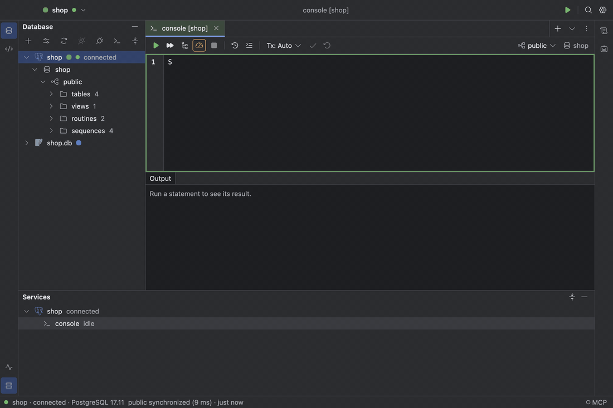

# Completion and navigation

Completion runs in the engine against a cache of the catalog. After `FROM` it offers relations;
after `JOIN` it offers whole join conditions that follow foreign keys, such as
`customers c ON c.id = o.customer_id`; after `c.` it offers the columns of that alias. `⌃Space`
opens it anywhere. `Enter` inserts the selected option and keeps the rest of the word after the
caret; `Tab` replaces the whole word, as in DataGrip. In an expression it offers the server's
built-in functions with their parameters, return type and a line on what each does; MySQL and
TiDB get the full list for the server's version, so MySQL 8.4 never offers `PASSWORD` and TiDB
offers its own `TIDB_*` functions. Accepting one leaves the caret inside `()`, and a hint above
the call shows every overload with the parameter at the caret in bold; `⌘P` (Parameter Info)
brings it back and `Escape` hides it. `⌘B` (Go to Declaration) on an alias moves the caret to where it is defined, and
on a table opens its DDL. Completion follows `USE` and `SET search_path`: once one runs, the
console's toolbar shows the database or schema it is in and unqualified names complete there; a
`USE` above the caret in a script counts even before it runs. After `USE `, `SET search_path TO `
or `SET SCHEMA ` completion offers the databases or schemas themselves. Click the database or
schema in the toolbar to switch the console to another one; it runs the `USE` or
`SET search_path` for you.



See [Completion and navigation](../design/specification.md#completion-and-navigation).

## Snippets

Open **Find Action** and choose **Snippets…** to create, search, edit, preview or delete your
templates. The list starts empty. Give a snippet a name, a completion prefix and a **Snippet body**.
**Applies to** chooses **All text consoles**, **All SQL consoles**, or one installed data source type.
A new snippet defaults to the active data source's type, or All text consoles when none is active.
Type-specific snippets apply to every data source using that plugin, not just one connection;
the choices come from installed plugin names and identities, not syntax-highlighting dialects.

For example, save prefix `sel` for All SQL consoles with this body:

```sql
SELECT * FROM ${table} LIMIT 100;
```

For a Redis-scoped snippet, prefix `getkey` could insert:

```text
GET ${key}${cursor}
```

Type the prefix in a matching SQL or command console and accept the snippet from completion with
`Tab` or `Enter`. It appears alongside the console's usual suggestions. `Tab` and `Shift+Tab` move between editable
fields. `${table}`, `${schema}` and any other named field are text you fill in, not values fetched
from the database; repeated names edit together. `${cursor}` marks the final caret position and
inserts no text. `${key}` is editable text too. Inserting a snippet never runs it: finish the fields,
then run the SQL or command as usual. Editing templates and expanding them need no live database
connection. A command language without a recognized highlighter uses plain text, not SQL keywords.

Snippets are saved in `snippets.json` in your [profile folder](data-and-privacy.md), separately
from settings. Their bodies are plain text; do not put passwords or other secrets in them.
Older SQL-only snippets keep their SQL/dialect restrictions when loaded; reading does not rewrite
the file. The next successful create, update or delete saves the migrated version-2 document.

Future plugins that provide the existing SQL or command-console hooks can use snippets too. This
does not add etcd, Kafka or MongoDB plugins or promise execution support for those systems.
