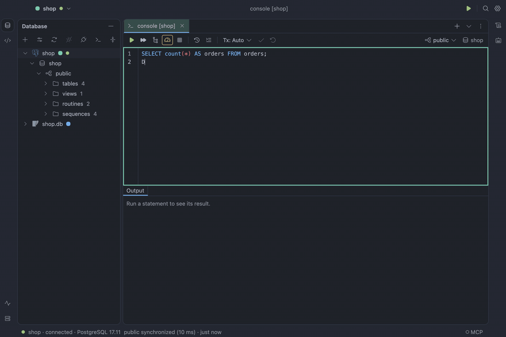
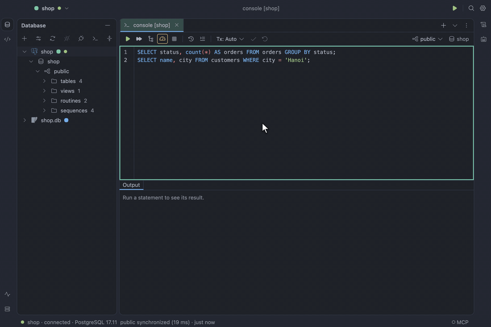
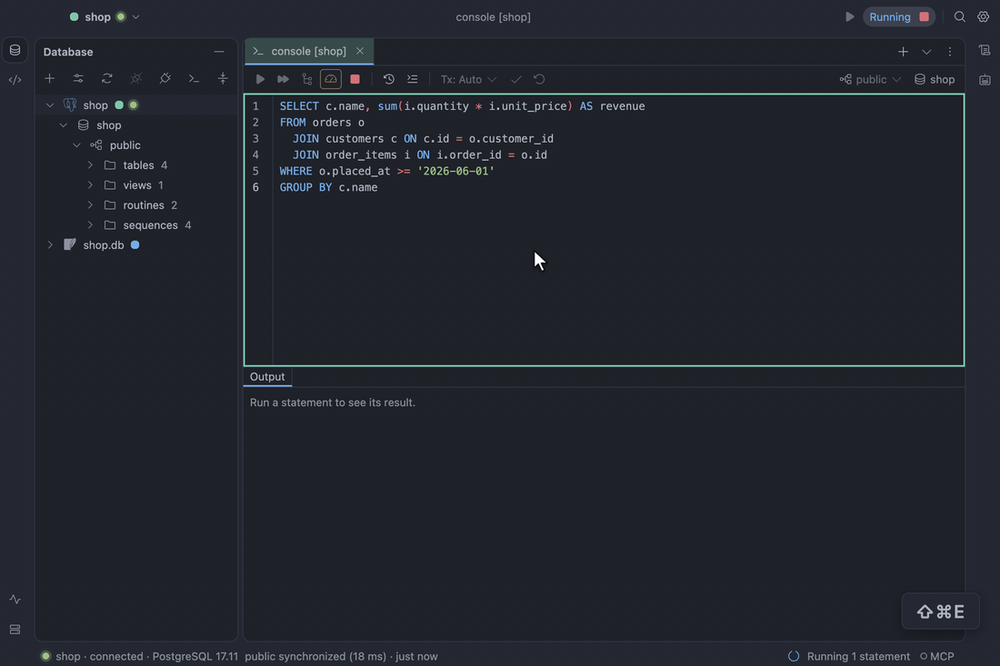

# SQL console

`⌘↩` runs the statement at the caret, or exactly the selected text; `⇧⌘↩` runs the whole console. Each result
opens its own tab next to **Output**, which logs every statement with its row count and time,
followed by the warnings and notices the server left about it (MySQL's and TiDB's `SHOW WARNINGS`,
PostgreSQL's `RAISE NOTICE`); the result tab shows how many warnings there were.
`UPDATE` or `DELETE` without a `WHERE`, `DROP` and `TRUNCATE` are listed in a confirmation before
anything runs. Switch
**Tx: Auto** to **Tx: Manual** to work in a transaction, then **Commit** or **Rollback**. Consoles
are saved as files as you type. Drag the line between the editor and its results to give either
more room; every console keeps the split you last dragged to, across launches.

**Open File…** (`⌘O`) opens `.sql` files from anywhere on disk, such as the migrations in your
project, as file consoles on the data source you are in; each file remembers its data source and
schema for next time, and **File → Recent Files** lists the last ten. A file console saves itself
as you type, as DataGrip does; its tab shows a dot until the write lands. **Save** (`⌘S`) in a
scratch console and **Save As…** (`⇧⌘S`) in any console write it to a file of your choosing, which
it then follows, and **Rename File…** renames the console or the file. When another program
changes the file, a clean console reloads it as the window comes back to the front; one with edits
not yet written shows a banner to reload or keep yours, and is never written over without asking.
Files are UTF-8; Windows line endings are kept as they were.

Right-click an editor tab to close the others, all, or those to its right; to copy its file's path,
show it in Finder (or its folder elsewhere) or rename it; to **Duplicate** it as a new console on
the same data source and schema; or to **Pin** it at the left, where closing many tabs leaves it
open. **Reopen Closed Tab** (`⇧⌘T`) brings back the consoles you closed, newest first.

Drag a tab toward the left or right side of the editor, or right-click it and choose **Split Left**
or **Split Right**, to work in two consoles side by side. Each side keeps its own selected tab;
click inside one to send Run, shortcuts and new consoles there. Drag the divider to resize them.
Splitting moves the existing console, keeping its text, results and connection. With two sides
already open, splitting moves the tab to that side; **Unsplit** brings all tabs together. Closing
the last tab on one side also removes the split. Bulk tab closing and next/previous tab stay within
the selected side. Saved console and table tabs remember their sides and the divider width.

**Run SQL Script…**, on a data source or schema in the Database pane, runs one or more `.sql` files
without opening them: the files are streamed, so a multi-gigabyte dump uses flat memory, and the
run shows its statements and bytes under **SQL Scripts** in Services, where you can cancel it. A
failing statement is handled as in a console run (below): the line asks **Skip**, **Skip All**,
**Stop** or **Retry**, a run that went on ends `done, 2 failed`, and **Go to statement** opens the
file where the database pointed, every failure of that file underlined.

When a statement fails, the console underlines where the database says it went wrong, with a mark in
the gutter and the message on hover; **Go to Error** beside the error jumps there, and `F2` / `⇧F2`
step through the marks. Editing the statement drops its mark. When one of several statements fails,
the run asks above the results: **Skip** it, **Skip All** failures from now on, **Stop**, or
**Retry**. Settings → Advanced → Running → _When a statement fails_ can stop or continue without asking; a run that
went on ends with `12 run, 2 failed.` in Output. In an open transaction PostgreSQL refuses every
later statement until it is rolled back, and Output says so.

While you type, the console checks SQL the way DataGrip does, without running anything: an empty
`WHERE`, a reserved word used as a table name or an unknown column is underlined in red, a
`DELETE` without `WHERE` or `= NULL` in amber, and a redundant `ASC` or alias is greyed out. Hover
a mark for its message and fixes; `⌥↩` (Show Context Actions) at the caret lists them, with
**Suppress for statement**, which writes a `-- noinspection <Id>` line above it, and **Disable
inspection**. `F2` / `⇧F2` visit these too, errors first. Settings → Editor → Inspections turns each
check, or all of them, off. The checks know your tables once the data source is connected.

**Reformat Code** (`⌥⌘L`) lays out the selection, or the whole console, and one `⌘Z` takes it
back. Queries get the aligned layout: the first item on the keyword's line, the rest of a list
under it, `AS` lined up, `AND`/`OR` under `WHERE`; other statements keep the standard layout. A statement with `:name`, `?` or (on PostgreSQL) `$1` placeholders asks for their values
before it runs; they are bound by the driver, never pasted into the SQL, and the next run starts
from them.

See [SQL console](../design/specification.md#sql-console).

## Explain

**Explain Plan** (`⇧⌘E`) shows the plan of the statement at the caret as a tree with estimated rows
and cost; select a node to see its details. **Explain Analyse** runs the statement and adds actual
rows, time and loops; when the statement writes, it asks first. PostgreSQL, MySQL, TiDB and Oracle
support both (Oracle's Explain Analyse needs `SELECT_CATALOG_ROLE`); SQLite has Explain Plan only. Warnings the server gives while planning, such as a hint it
could not apply, show in Output and on the plan tab.

See [Explain](../design/specification.md#explain).
