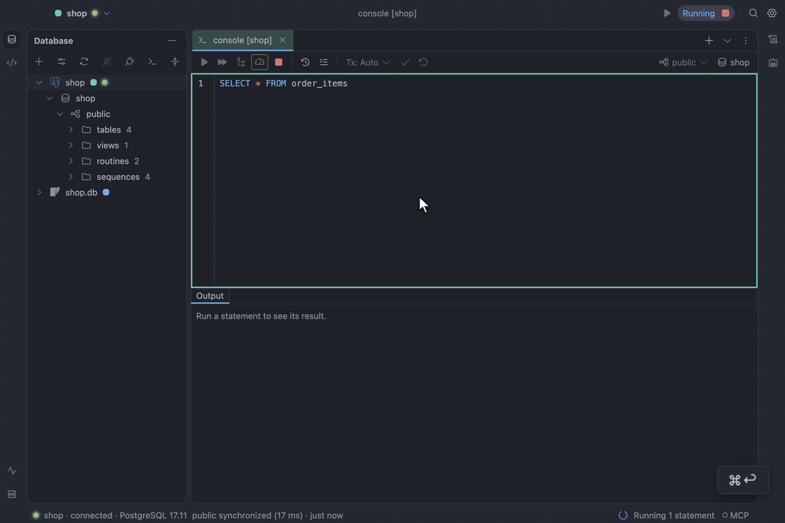
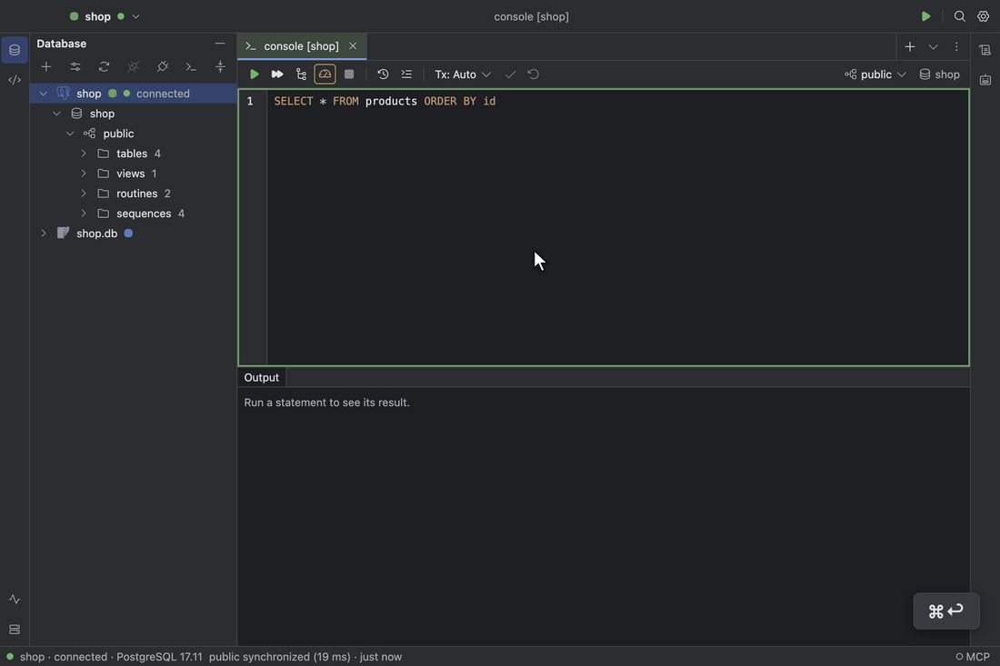
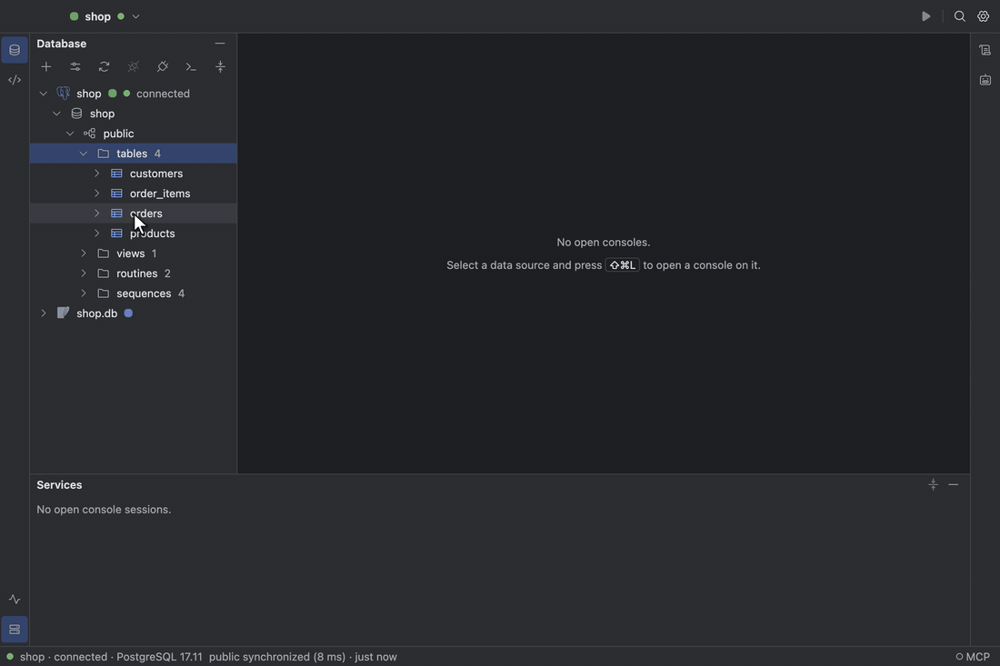
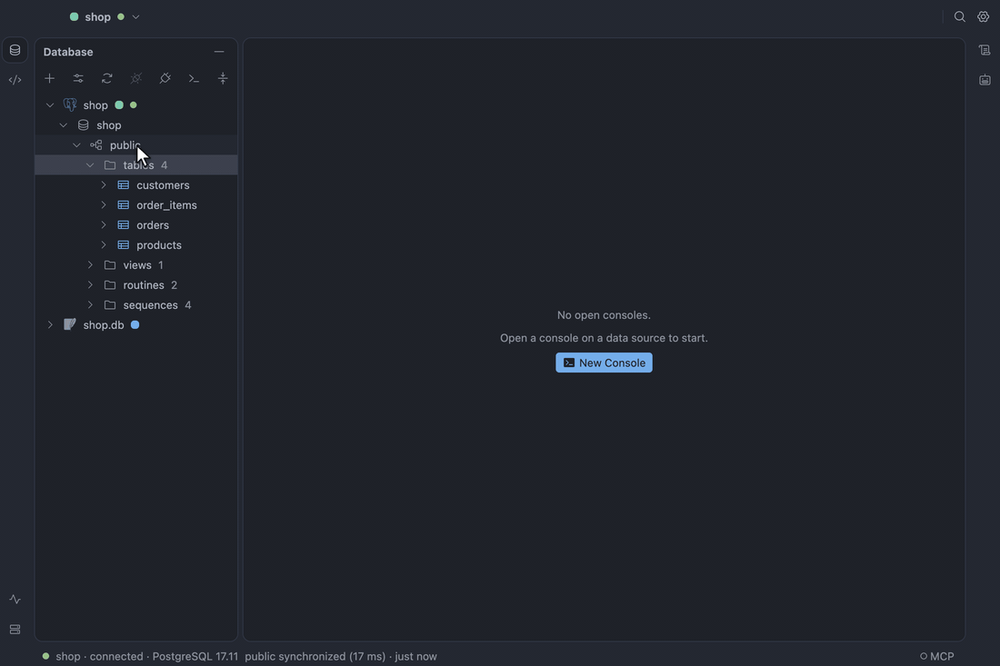

# Results and table data

The result grid, the table data editor, and importing a file into a table.

## Result grid

The grid shows the first page (500 rows by default) and keeps the cursor open: **Fetch Next Page**
and **Fetch All** read more. Clicking a header sorts ascending, descending, then not at all; `⌥`-click
adds a second key. `⇧↩`, or double-clicking a cell, opens the value panel for long text and JSON. **Copy** on one
cell copies its bare value; on more it uses the chosen extractor: CSV, TSV, JSON, SQL Inserts or
Markdown. **Export Data…**, on a result or on a
table in the Database pane, writes any of those or Excel (XLSX) in the background: it streams
straight to disk, so a multi-gigabyte export uses flat memory, shows its progress under **Exports**
in Services, and never leaves a half-written file behind when the network drops, the disk fills or
you cancel.

**Find in Result** (`⌘F` in the grid) searches the fetched rows as the grid draws them, with Match
Case, Regular Expression and Whole Cell toggles; `↩` and `⇧↩` step through the matches and
**Filter Rows** hides the rows without one. A column header's menu filters by the focused row's
value, excludes it, or keeps `NULL` or non-`NULL` cells, as removable chips. Both run on the rows
already fetched and say so; **Search All Rows** fetches the rest. Copy takes the rows you see, and
Export asks whether to write the visible rows or the whole result. In the table editor the local
filter sits beside the `WHERE` bar, which still filters on the server.

Select two or more cells and the line under the grid shows their count, distinct values and, for
numbers, an exact sum, average, minimum and maximum; click it to copy, and its menu picks which
show. **Transpose** (`⌥⌘T`) turns records into columns, handy for a wide row. A binary value's
panel saves it to a file, loads a file into the cell, and draws it when it holds a PNG, JPEG, GIF
or WebP image.

The value panel shows JSON formatted and coloured: a `json` or `jsonb` column, and a text column
whose value is a JSON object or array, such as a `varchar` holding `{"domain":"PAYMENT",…}`. A
muted line says it is shown formatted and stored as is. `{}` in the panel's header, or **Toggle
JSON View** (`⌥⌘J`), switches that column back to the exact stored text and keeps it so as you move
between rows, until the next run. Turn off **Detect JSON in text values** in Settings → Data Editor
to open text raw by default.

See [Result grid](../design/specification.md#result-grid).

## Table data editor

`F4` on a table opens its rows in a tab with a `WHERE` bar and an `ORDER BY` bar. Edit cells in
place, add rows with `⌘N` and delete them with `⌘⌫`; changes stay pending and highlighted until you
submit. **Preview Pending Changes** (`⇧⌘P`) shows the SQL, and **Submit** (`⌘↩`) runs it in one
transaction: if any statement fails or touches more than one row, everything rolls back and your
edits stay. `⌘B` on a foreign key cell opens the referenced row. A boolean cell edits in a
true/false/NULL list and `Space` flips it; a date or timestamp cell has a calendar picker beside its
text, in the app's theme, that you can drive with the mouse or the arrow keys.

A console result is editable too when it reads one table and shows its primary key, as
`SELECT * FROM orders WHERE …` does: the same chords edit it, and **Submit** runs on the console's
own session, so in manual commit mode your edits wait in its open transaction for **Commit**.
Joins, aggregates, `DISTINCT` and results without a key stay read-only, and the toolbar says why;
computed columns in an editable result take no edits.

The value panel edits JSON formatted too. A value stored compact is written back compact, with only
your change; one stored indented is written as you typed it. Text that is no longer JSON is saved
as typed, under a `Not valid JSON — saved as typed` warning.

See [Table data editor](../design/specification.md#table-data-editor).

## Import

**Import Data from File…** on a table, or **Import Data into New Table…** on a schema, reads a CSV
or TSV file into it. The dialog previews the first rows with the delimiter, quote, encoding
(UTF-8 or UTF-16, detected by its BOM), header and NULL text you choose, maps columns by name, and
for a new table infers the column types and shows the `CREATE TABLE` before it runs. The file is
streamed, so a multi-gigabyte import uses flat memory, and it runs in the background under
**Imports** in Services. By default it is all or nothing: a bad row, a cancel or a dropped
connection rolls everything back. Choose **Commit every N rows** to keep what was written and
**Resume** from the first row that was not, and **Skip** to set bad rows aside in
`<file>.rejected.csv` with the reason for each.

See [Import](../design/specification.md#import).
