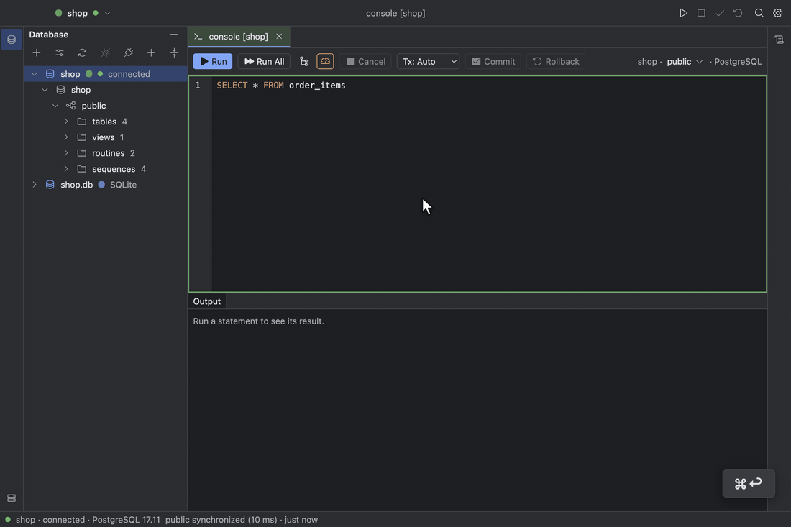
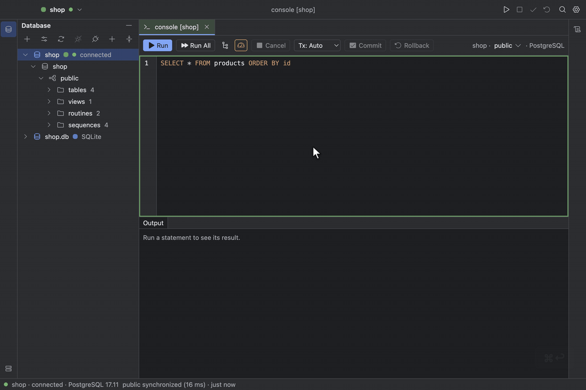
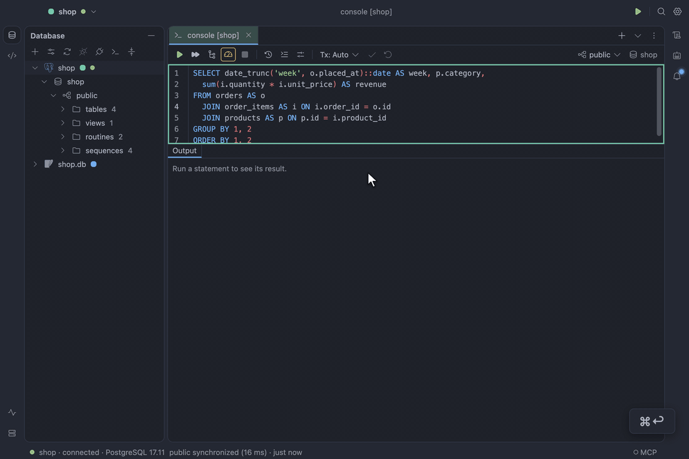
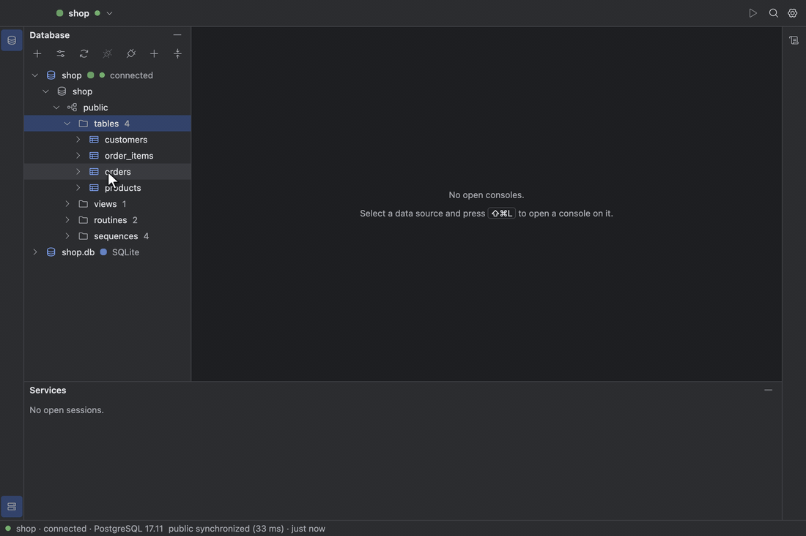
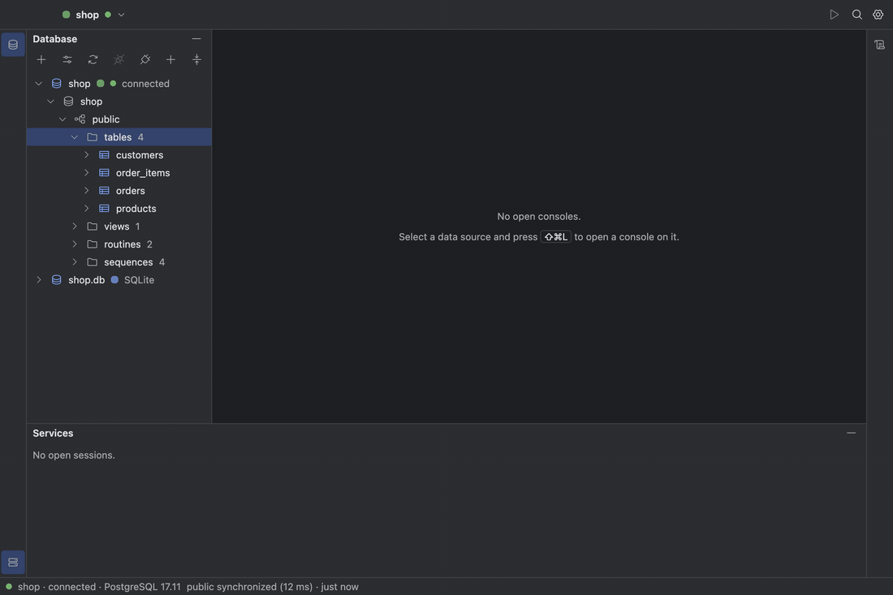

# Results and table data

The result grid shows what a statement returns, the table data editor changes a table's rows in a
tab of their own, and an import reads a file into a table.

## Result grid

The grid shows the first page of a result, 500 rows by default.

### Fetch more rows

To read past the first page, click **Fetch Next Page** or **Fetch All**.

A plain `SELECT` carries the page size as a row limit in its SQL, so the server stops there. Both
buttons run it again with a larger limit, and the rows may differ if the query has no `ORDER BY`.
Other statements, and every statement once **Row limit** is off in **Settings → Data Editor**, keep
the cursor open and read on from it.

### Sort rows

Click a column header to sort ascending, click again for descending, and a third time to drop the
sort. `⌥`-click another header to add a second key.

### Open a value

To read long text or JSON, double-click a cell or press `⇧↩`. The value panel opens. Drag its left
edge to widen it, and it keeps that width.

The panel shows JSON formatted and coloured. That covers a `json` or `jsonb` column, and a text
column whose value is a JSON object or array, such as a `varchar` holding
`{"domain":"PAYMENT",…}`. A muted line says the value is shown formatted and stored as is.

To see the exact stored text, click `{}` in the panel's header or press `⌥⌘J` (**Toggle JSON
View**). The column stays that way as you move between rows, until the next run. To open text raw
by default, turn off **Detect JSON in text values** in **Settings → Data Editor**.

A binary value's panel saves the value to a file, loads a file into the cell, and draws the value
when it holds a PNG, JPEG, GIF or WebP image.

### Copy cells

**Copy** on one cell copies its bare value. On more than one cell it uses the extractor you chose:
CSV, TSV, JSON, SQL Inserts or Markdown.

### Export a result

To export, choose **Export Data…** on a result or on a table in the Database pane. It writes any of
the copy formats, or Excel (XLSX).

The export runs in the background and streams straight to disk, so a multi-gigabyte export uses
flat memory. It never leaves a half-written file behind when the network drops, the disk fills or
you cancel.

### Follow an export

While an export runs, the **Exports** chip in the status bar shows the file name, the rows written
(or the percent, when the row count is known), a bar and a clock. Its red stop button cancels the
export.

Click the chip to see every export of the session, each with its rows of the total, size, rows a
second and time left when it can be told. Each has **Cancel**, **Reveal**, **Retry** or **Remove**,
and **Cancel All Exports** stops several at once.

A finished export stays on the chip for a few seconds, and a failed one turns the chip red until you
open it. The grid an export drains shows its rows, clock and a **Cancel** of its own, and Services
lists the same tasks under **Exports**.

### Find in the fetched rows

1. Click in the grid and choose **Find in Result** or press `⌘F`.
2. Type what to find. Turn on **Match Case**, **Regular Expression** or **Whole Cell** if you need
   them.
3. Press `↩` and `⇧↩` to step through the matches.
4. Click **Filter Rows** to hide the rows without a match.

The search reads the cells as the grid draws them.

### Filter by a cell's value

A column header's menu filters by the focused row's value, excludes it, or keeps `NULL` or
non-`NULL` cells. Each filter shows as a chip you can remove.

Find and these filters run on the rows already fetched, and the grid says so. **Search All Rows**
fetches the rest. Copy takes the rows you see, and Export asks whether to write the visible rows or
the whole result. In the table editor this local filter sits beside the `WHERE` bar, which still
filters on the server.

### Sum a selection

Select two or more cells. The line under the grid shows their count and distinct values and, for
numbers, an exact sum, average, minimum and maximum. Click the line to copy it, and use its menu to
pick which values show.

### Transpose a row

To turn records into columns, choose **Transpose** or press `⌥⌘T`. It helps with a wide row.

### Draw a chart

Choose **Show Chart**, click **Chart** in the grid's toolbar, or press `⌥⌘C`. The rows you have
fetched are drawn as a chart, in a console result and in the table editor alike.

TableCraft picks the kind from the columns:

- a date and a number: a line over time
- a text column and a number: a bar per value
- two numbers: a scatter
- one number: a histogram
- open, high, low and close columns beside a date: a stock chart

### Change the chart

The chart bar above the chart switches between Bar, Line, Area, Pie, Scatter, Histogram and Stock.
It also picks:

- the X axis
- the values, where **+ Value** adds a series
- a **Group by** column that splits the values into series
- how rows with the same label fold: sum, average, count, minimum or maximum
- a histogram's bins

When the columns cannot draw a kind, pointing at it says what it needs.

The chart follows the grid. It plots the rows the grid shows, after its sort and local filter, and
redraws as you **Fetch All**. The line under it says how many rows it plots, whether more wait on
the server, and how many it skipped because the value was `NULL` or not a number.

Zoom a time or number axis with the wheel, then choose **Reset Chart Zoom** to go back. To save the
drawing, click **Export Chart as PNG…** at the right of the chart bar. The chart keeps its settings
when you rerun the statement, as long as its columns are still there, and takes the colours of the
current theme.

See [Result grid](../design/specification.md#result-grid).

## Table data editor

Press `F4` on a table to open its rows in a tab with a `WHERE` bar and an `ORDER BY` bar.

### Edit rows

1. Edit cells in place, add rows with `⌘N` and delete them with `⌘⌫`.
2. Choose **Preview Pending Changes** or press `⇧⌘P` to read the SQL.
3. Click **Submit** or press `⌘↩`.

Changes stay pending and highlighted until you submit. Submit runs them in one transaction. If any
statement fails or touches more than one row, everything rolls back and your edits stay.

A boolean cell edits in a true/false/NULL list, and `Space` flips it. A date or timestamp cell has a
calendar picker beside its text, in the app's theme, that you can drive with the mouse or the arrow
keys.

To open the row a foreign key points to, press `⌘B` on its cell.

### Edit a console result

A console result is editable when it reads one table and shows its primary key, as
`SELECT * FROM orders WHERE …` does. The same chords edit it, and **Submit** runs on the console's
own session, so in manual commit mode your edits wait in its open transaction for **Commit**.

Joins, aggregates, `DISTINCT` and results without a key stay read-only, and the toolbar says why.
Computed columns in an editable result take no edits.

### Edit JSON

The value panel edits JSON formatted too. A value stored compact is written back compact, with only
your change, and one stored indented is written as you typed it. Text that is no longer JSON is
saved as typed, under a `Not valid JSON — saved as typed` warning.

See [Table data editor](../design/specification.md#table-data-editor).

## Copy PostgreSQL databases and schemas

In the Database pane, select a PostgreSQL data source and choose **Copy Database to…** to copy all
non-system schemas to another PostgreSQL data source. Select a schema and choose **Copy Schema
to…** to copy only that schema. Both actions offer schema and data, schema only, or data only. For
schema-and-data and data-only, choose which tables' rows to copy; all tables are selected initially.
Schema-and-data still creates every supported schema object, while data-only checks and writes only
selected tables. A live progress dialog shows the current schema statement or table, step count, and
rows copied for the active table.

The destination database must already exist. Schema and data copy creates missing schemas, tables,
views and materialized views. It stops before writing if selected object names already exist. Data
only requires selected destination tables to exist with matching layouts and be empty. Rows are sent in bounded batches,
with each table's inserts committed or rolled back together. Database copy checks all selected
schemas for conflicts before it starts.

**Verify Schema or Data…** on a selected schema compares supported relation definitions, or row
counts and type-tagged content digests. Verification reads both databases and does not write to
them. Unsupported values are reported as unverifiable.

Copy and verification run locally in TableCraft. Database rows are not uploaded to a cloud or
third-party service. The current release does not copy routines, triggers, standalone sequences or
sequence counters. Data copy stops for circular, self-referencing, or cross-schema foreign keys.
Text, booleans and safe finite numbers are copied through bound SQL parameters. Binary and
structured row values, generated columns, non-finite numbers, and integers outside JavaScript's safe
range stop that table and roll back its inserts. Tables completed before a later failure remain
copied.

## Copy and verify MySQL databases

Select a MySQL database in the Database pane and choose **Copy Database to…**. Choose the same MySQL
connection or another one, then select an existing non-system database on it. The target database
can have a different name from the source. Choose schema and data, schema only, or data only. For
schema-and-data and data-only, choose which tables' rows to copy; all tables are selected initially.
Schema-and-data still creates every supported schema object, while data-only checks and writes only
selected tables. Schema-bearing modes stop when an object with the same name already exists;
data-only requires matching table layouts and empty selected tables. Copy never creates the target database or overwrites its
objects. A live progress dialog shows each schema object and table batch, including rows copied for
the active table. Schema-bearing copies proceed without routines, triggers, or events and report how
many of each were omitted. Data moves in bounded batches with bound parameters and per-table InnoDB
transactions.

Choose **Verify Schema or Data…** on a selected MySQL database to compare table and view definitions,
or compare per-table row counts and local content digests. Verification is read-only. MySQL DDL
implicitly commits, so a later schema error can leave earlier objects in place. Routine, trigger,
and event definitions are not copied or verified. Generated columns, non-InnoDB tables, and
circular, self-referencing, or cross-database foreign keys stop the copy. Binary row values cannot
be copied or verified; other values that
cannot be safely represented by bound SQL parameters stop the table copy or are reported as
unverifiable. MySQL `AUTO_INCREMENT` counters are not preserved.

MySQL copy and verification run locally in TableCraft. Database rows are not sent to a cloud or
third-party service.

## Import

An import reads a CSV or TSV file into a table, or into a new one.

### Import a file

1. Choose **Import Data from File…** on a table, or **Import Data into New Table…** on a schema.
2. Click **Browse…** and pick the file.
3. Set the delimiter, quote, encoding (UTF-8 or UTF-16, detected by its BOM), header and NULL text.
   The preview shows the first rows with what you chose.
4. Check how the columns map, by name. For a new table, check the column types it inferred and the
   `CREATE TABLE` it shows.
5. Click **Import**.

The import runs in the background under **Imports** in Services. The file is streamed, so a
multi-gigabyte import uses flat memory.

### Choose what happens on a failure

By default an import is all or nothing: a bad row, a cancel or a dropped connection rolls
everything back.

- **Commit every N rows**: keeps what was written, and **Resume** carries on from the first row that
  was not. Use it when a large file should not start over after a dropped connection.
- **Skip up to N rows**: sets bad rows aside in `<file>.rejected.csv`, with the reason for each. Use
  it when a few bad rows should not stop the rest.

See [Import](../design/specification.md#import).
