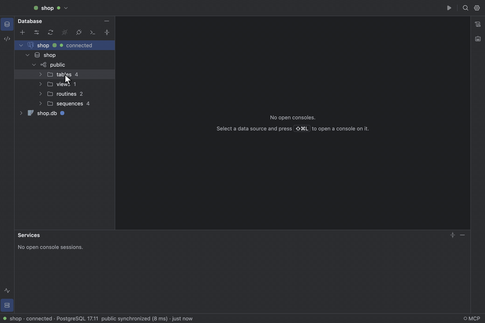
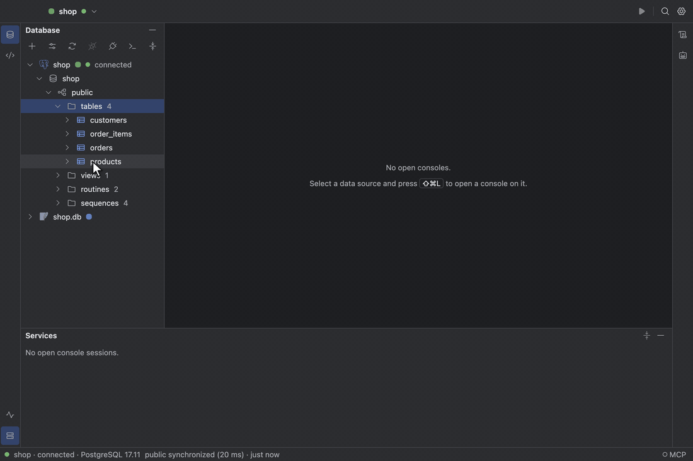
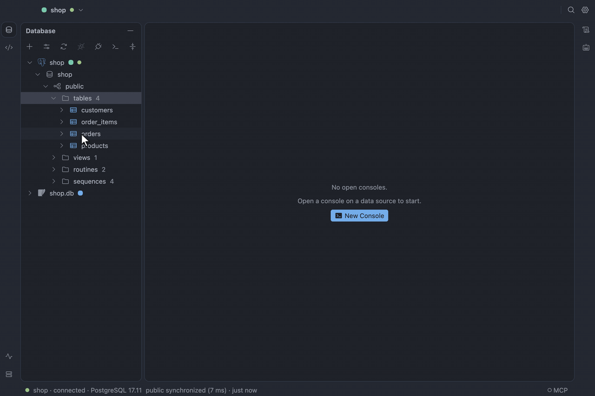
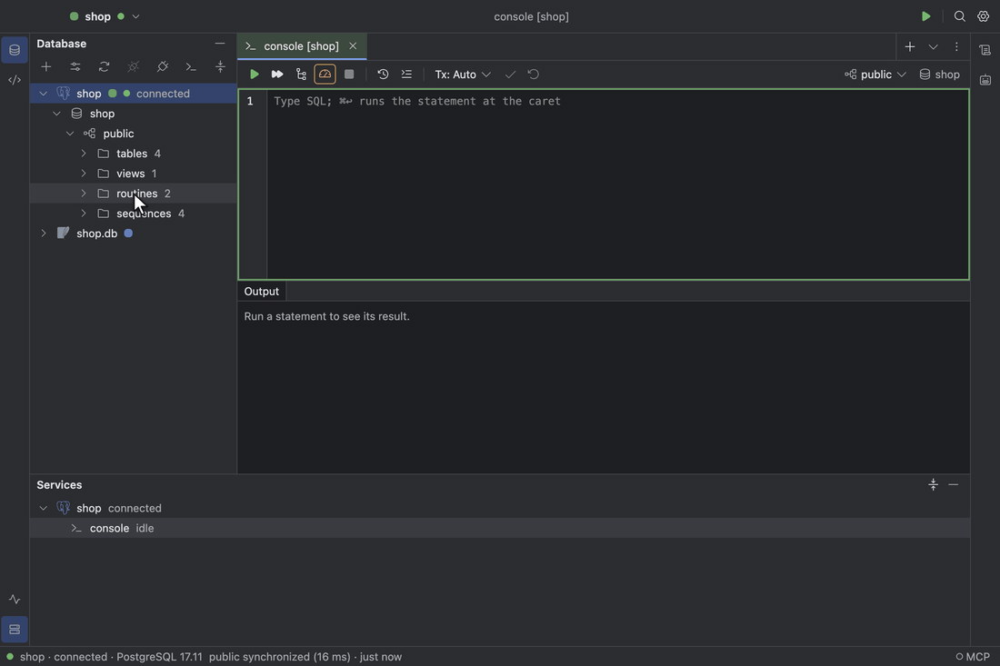

# Database explorer

The Database tool window (`⌘1`) is a lazy tree: data source, schemas, then `tables`, `views` and
their columns, keys, foreign keys and indexes. Expanding a disconnected data source connects it.
Typing in the tree starts speed search, `F1` shows Quick Documentation for the selected object, and
`⌘B` opens its DDL. **Synchronize** (`⌥⌘Y`) reloads the tree from the database.

On a server with many databases, **Manage Shown Schemas…** on a data source picks which databases
or schemas the tree lists, as DataGrip does; the data source then shows how many of them it lists,
such as `3 of 40`. Ones created later stay hidden until you pick them, unless **All schemas** is on.

A [Redis](redis.md) or [etcd](etcd.md) data source expands into its keys instead. Tick
**Load keys only when asked** under Options in the Data Sources dialog to have it list only its
databases and their key counts; each database then waits behind a **Scan** (Redis) or **List**
(etcd) row until you choose it, filter, or Load More Keys.

Each data source shows the logo of the database it is: MySQL, MariaDB or TiDB (whichever the server
says it is on connect), PostgreSQL, SQLite or Redis, in the tree, the Data Sources dialog and the
Services tool window. **View → Brand Icons**, **Toggle Brand Icons** in Find Action, or Settings ›
Appearance › Data sources turns them off for the generic database glyph and the product's name.
Logos take their brand's colour, fitted to the theme; Settings › Appearance › Data sources › Logo
colour draws them in gray instead.

The tree's context menu also changes the database: **New Table…** on a schema, **Modify Table…**
(`⌘F6`) on a table, **Rename…** (`⇧F6`), **Truncate…** and **Drop…** (`⌘⌫`). Every change shows
the DDL it will run first, and **Open in Console** takes it to a console instead. On PostgreSQL and
SQLite it runs in one transaction, so a failing statement leaves nothing changed; MySQL commits each
DDL statement, and its preview says so. Drop and Truncate name the object and its row count, and
Cascade is a checkbox where the database has it. SQLite rebuilds a table for a change its `ALTER
TABLE` cannot make.

See [Database explorer](../design/specification.md#database-explorer).

## DDL and SQL generation

`⌘B` on a table or view opens its definition, read from the database, in a DDL tab you can copy or
open in a console. The **SQL Generator** (`⌥⌘G`) writes `CREATE`, `DROP`, `SELECT`, `INSERT` or
`UPDATE` statements for the selected objects and opens them in a console.

See [DDL and SQL generation](../design/specification.md#ddl-and-sql-generation).

## Execute a routine

The tree lists each function and procedure under Routines with its arguments, so every PostgreSQL
or Oracle overload has its own row; an Oracle package's members are listed as `PACKAGE.MEMBER`. **Execute Routine…** on one opens a dialog with a field per argument, a
NULL toggle and, where the argument has a default, a DEFAULT toggle; OUT arguments are listed as
what comes back, and the SQL it will run is shown as you type. **Run** opens a new console on the
routine's schema with that SQL and runs it, values bound rather than pasted in, so the result, the
OUT values and server messages show in the usual result tabs and Output. **Open in Console** opens
the same console without running it. PostgreSQL, MySQL and Oracle support it; an Oracle
`SYS_REFCURSOR` comes back as a result tab.

See [Execute a routine](../design/specification.md#execute-a-routine).
