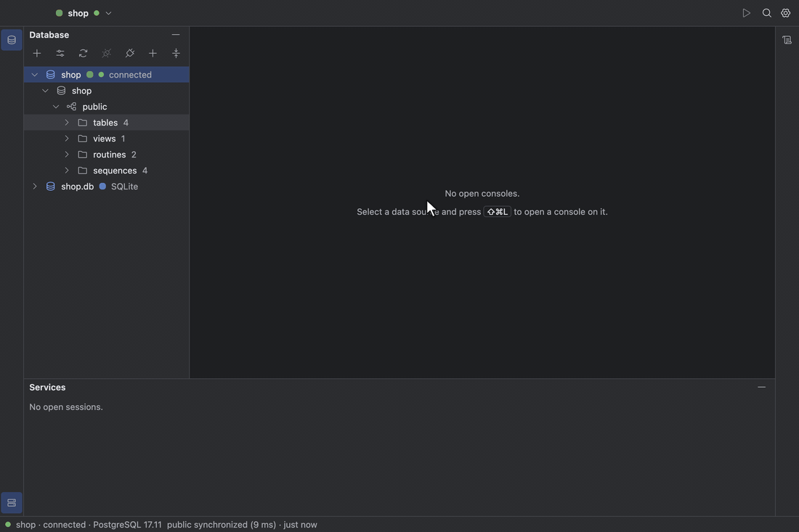
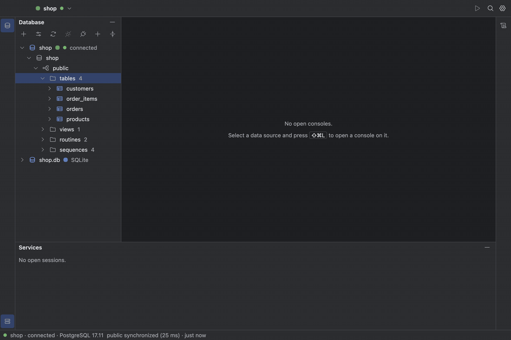
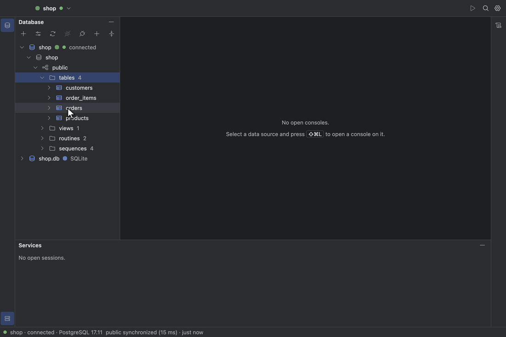
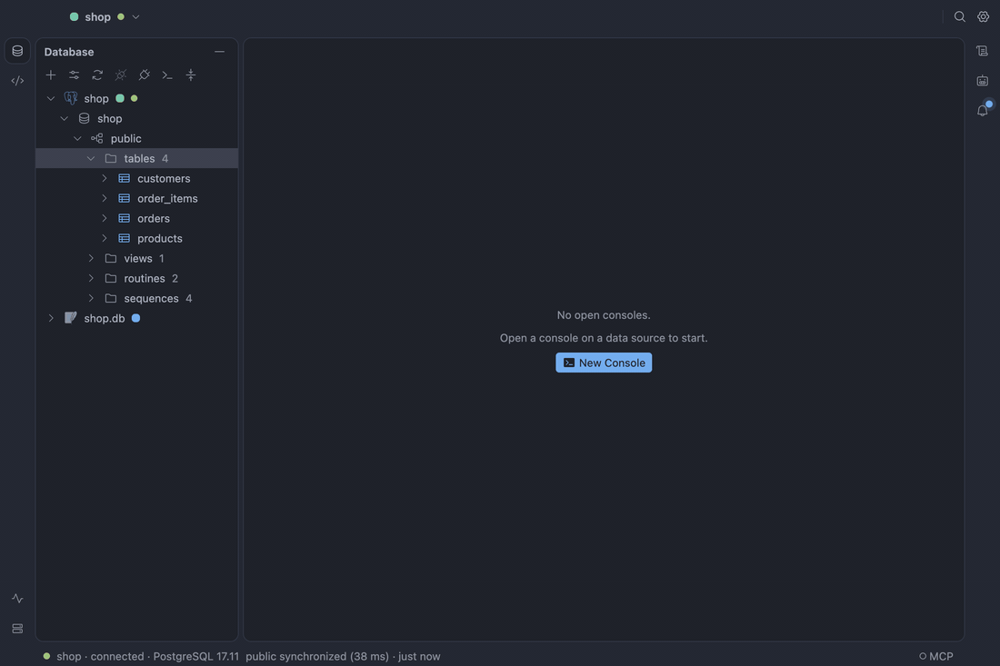
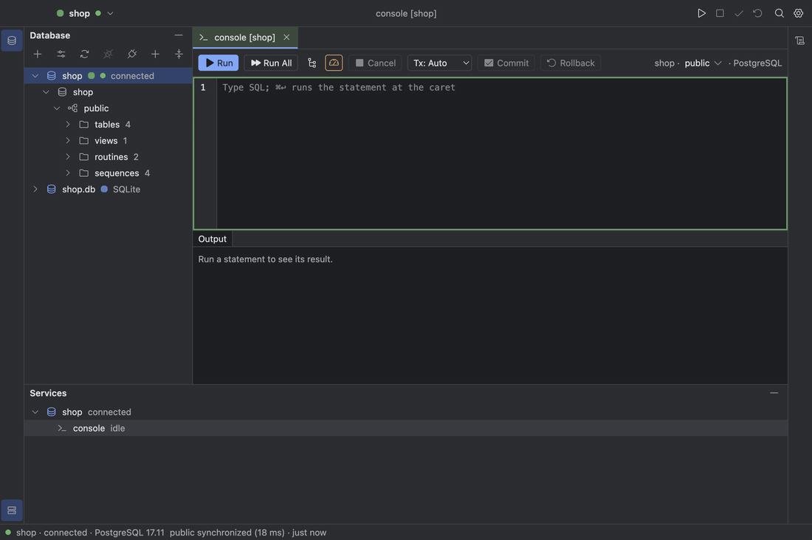

# Database explorer

The Database tool window (`⌘1`) is a lazy tree: data source, schemas, then `tables`, `views` and
their columns, keys, foreign keys and indexes. Expanding a disconnected data source connects it.

## Database tree

A connected data source's green dot pulses while one of its consoles runs a statement, as it does
in the status bar and the title bar.

### Find and inspect an object

Typing in the tree starts speed search, `F1` shows Quick Documentation for the selected object, and
`⌘B` opens its DDL. **Synchronize** (`⌥⌘Y`) reloads the tree from the database.

### Choose the schemas the tree shows

On a server with many databases, **Manage Shown Schemas…** lists the connectable databases and
schemas. Pick databases to add them under the same data source; they use its credentials and are
not saved as separate connections. Newly created databases stay hidden until picked. Schema
visibility has its own **All schemas** choice, so future databases stay hidden by default.
Kafka and Elasticsearch data sources have **Manage Shown Topics…** and **Manage Shown Indices…**
instead.

### Browse keys on Redis or etcd

A [Redis](redis.md) or [etcd](etcd.md) data source expands into its keys instead. Tick **Load keys
only when asked** under Options in the Data Sources dialog to have it list only its databases and
their key counts. Each database then waits behind a **Scan** (Redis) or **List** (etcd) row until
you choose it, filter, or **Load More Keys**.

### Turn off the database logos

Each data source shows the logo of the database it is: MySQL, MariaDB or TiDB (whichever the server
says it is on connect), PostgreSQL, SQLite or Redis, in the tree, the Data Sources dialog and the
Services tool window. Logos take their brand's colour, fitted to the theme.

- To show the generic database glyph and the product's name instead, use **View → Brand Icons**,
  **Toggle Brand Icons** in Find Action, or **Settings → Appearance → Data sources**.
- To draw the logos in gray, use **Settings → Appearance → Data sources → Logo colour**.

### Open a console on an object

**New Console** on a database, schema, table, column or routine opens a console already switched to
the database or schema that holds it, as the console's schema switcher would. On a data source, or
where the data source cannot switch, the console starts where a connection lands.

## Schema changes

The tree's context menu also changes the database:

- **New Table…** on a schema
- **Modify Table…** (`⌘F6`) on a table
- **Rename…** (`⇧F6`)
- **Truncate…** and **Drop…** (`⌘⌫`)

Every change shows the DDL it will run first, and **Open in Console** takes it to a console instead.
Drop and Truncate name the object and its row count, and **Cascade** is a checkbox where the
database has it.

### Change a table

1. Right-click a table in the Database pane and choose **Modify Table…**, or press `⌘F6`.
2. Change the design in the dialog's tabs.
3. Read the DDL in the preview under them.
4. Click **Apply**, or **Open in Console** to run the DDL yourself.

On PostgreSQL and SQLite the change runs in one transaction, so a failing statement leaves nothing
changed. MySQL commits each DDL statement, and its preview says so. SQLite rebuilds a table for a
change its `ALTER TABLE` cannot make.

See [Database explorer](../design/specification.md#database-explorer).

## Arranging data sources

The tree keeps data sources and folders in the order you put them. Folders come first in each
level. New data sources and folders go last in their folder. Folders you create stay after a
restart, even empty. A data source from `TABLE_CRAFT_DATASOURCE` stays first and does not move.

### Move a data source or folder

Drag it. Where you drop it decides where it lands:

- On the top or bottom half of a data source: before or after it.
- On the middle of a folder: inside it, last.
- Below the last row: at the end of the top level.

A blue line shows where it lands, a folder you hover over opens after a moment, and dragging near
the top or bottom edge scrolls. Folders drag too, with everything in them.

### Work on several at once

`⌘`-click (`Ctrl`-click) adds or removes a row from the selection, `⇧`-click or `⇧↑`/`⇧↓` select a
range, and `Esc` keeps only the row you are on. Dragging a selected row moves the whole selection.

**Move to Folder…** and **Delete** act on everything selected and ask once. A folder can be deleted
only with everything inside it selected too. **Move Up** and **Move Down** (`⌥⇧↑`/`⌥⇧↓`) step the
selection within its folder.

## DDL and SQL generation

### Read an object's DDL

`⌘B` on a table or view opens its definition, read from the database, in a DDL tab you can copy or
open in a console.

### Generate statements

The **SQL Generator** (`⌥⌘G`) writes `CREATE`, `DROP`, `SELECT`, `INSERT` or `UPDATE` statements
for the selected objects and opens them in a console.

### Write a schema's DDL as one script

**SQL Scripts** on a schema's context menu writes the DDL of every table, view and materialized view
in it as one script. On the Tables or Views node it writes only those.

- **Generate DDL to Console**: opens it in a new console switched to that schema, or to its
  database where the console switches databases.
- **Generate DDL to Clipboard**: copies it.
- **Generate DDL to File…**: saves it as a background export you can follow and cancel in Services.

Tables come before the tables that reference them, then views. Tables that reference each other are
named in the script's header, so you can create them with foreign key checks off. Routines and
sequences are not included. A definition the database refuses becomes a comment in its place.

See [DDL and SQL generation](../design/specification.md#ddl-and-sql-generation).

## ER diagram

### Draw a diagram

**Diagrams → Show Diagram** (`⌥⇧⌘U`) on a schema or its Tables node draws its tables and the keys
between them in a diagram tab.

Keys the database declares draw solid. Many databases declare none, so the diagram also guesses: a
column such as `customer_id`, `customerId` or `shipping_address_id` whose type matches the one key
column of `customers` or `addresses` draws dashed. A guess is made only when exactly one table fits,
so a name that could mean two tables draws nothing. Guesses stay in the diagram: completion and Go to
Referenced Row use declared keys only.

### Correct the guessed keys

- Right-click a dashed edge and choose **Hide Inferred Key** when the guess is wrong, or **Keep as
  Virtual Key** to keep it.
- **Add Relationship…** in the toolbar, or **Add Relationship From Here…** on a table, draws a key
  the guess missed, such as `person_id` to `people`, as a dotted virtual key.
- **Hidden Keys…** lists what you hid, with **Restore**.
- **Show Inferred Keys** turns guessing off for the data source.

None of it changes the database.

### Lay out and export the diagram

Tables are laid out left to right, referencing tables before what they reference. Drag a table to
move it. Positions, hidden keys and virtual keys are saved per data source and come back after a
restart. **Re-layout Diagram** starts over.

The toolbar switches between all columns, key columns only and names only. **Tables** picks which
tables to draw. A schema of more than 200 tables opens with none drawn.

Double-click a table to open its data. **Export Diagram as SVG…** and **Export Diagram as PNG…**
save the whole diagram in the theme you are using.

See [ER diagram](../design/specification.md#er-diagram).

## Execute a routine

The tree lists each function and procedure under Routines with its arguments, so every PostgreSQL
or Oracle overload has its own row. An Oracle package's members are listed as `PACKAGE.MEMBER`.
PostgreSQL, MySQL and Oracle support running them.

### Run a function or procedure

1. Right-click it under Routines and choose **Execute Routine…**.
2. Fill in the field for each argument. Use the **NULL** toggle, or the **DEFAULT** toggle where the
   argument has a default.
3. Click **Run**.

A new console opens on the routine's schema with that SQL and runs it, values bound rather than
pasted in. The result, the OUT values and server messages show in the usual result tabs and Output.
An Oracle `SYS_REFCURSOR` comes back as a result tab.

The dialog lists OUT arguments as what comes back, and shows the SQL it will run as you type.
**Open in Console** opens the same console without running it.

See [Execute a routine](../design/specification.md#execute-a-routine).
