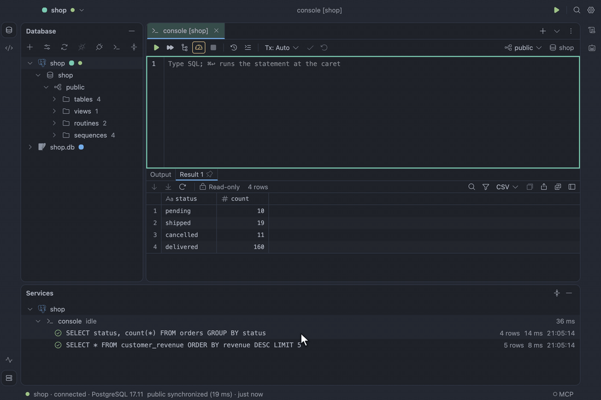
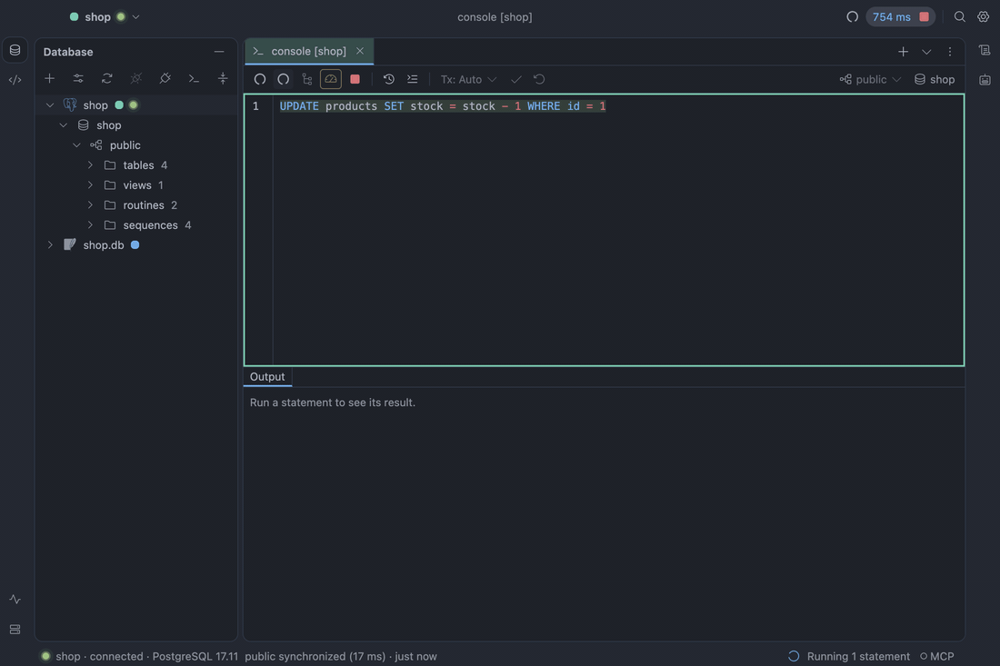

# History, sessions and the log

What you ran, what is running on the server, and what TableCraft itself did.

## Query history and Services

Every statement you run is kept per data source in a local history. **Query History…** (`⌥⌘E`)
searches it, and `↩` puts the chosen statement at the caret. The Services tool window (`⌘8`) shows
each connected data source, a session per tab, and its recent executions with outcome, rows,
duration and start time. **Expand All** and **Collapse All** in its header (`⌘=` and `⌘-` with focus
in Services) unfold and fold the whole tree.

See [Query history and Services](../design/specification.md#query-history-and-services).

## Sessions

**Show Sessions…** on a data source opens a tab that lists every session on the server: its PID,
state, user, database, client, how long its query and transaction have run, what it waits on, and
the sessions blocking it. Sessions idle in a transaction are tinted amber and blocked ones red; yours
are tagged. Filter by Hide idle, Hide system or Blocked only, or search; Refresh reads the list
again, and Auto-refresh does so every few seconds. Select a session to see its full query, open it
in a console or explain it, cancel its query, or terminate it after confirming the exact statement.
On a data source coloured red you type the PID to confirm, and a read-only data source cannot stop
anything. **Show in Sessions** on an execution in Services selects the console's own session.
PostgreSQL, MySQL, TiDB and Oracle support it; when your account cannot see everything, the tab
says which grant to ask for.

See [Sessions](../design/specification.md#sessions).

## App log and diagnostics

TableCraft keeps a log of what it does: launches, connections, statements by kind, row count and
duration, exports, engine restarts and errors. It records no passwords, no row values and no SQL
text. **Help → Show Log** opens the Log tool window, newest first, with filters for level, scope
and text; an error notice's **Show in Log** opens it on the records of that request. **Help →
Export Diagnostics…** saves a zip with the logs, versions, settings, data sources without
credentials and recent run metadata, for attaching to a bug report. Turn on **Debug logging** in
Settings → Advanced to record every request while reproducing a problem.

See [App log and diagnostics](../design/specification.md#app-log-and-diagnostics).
