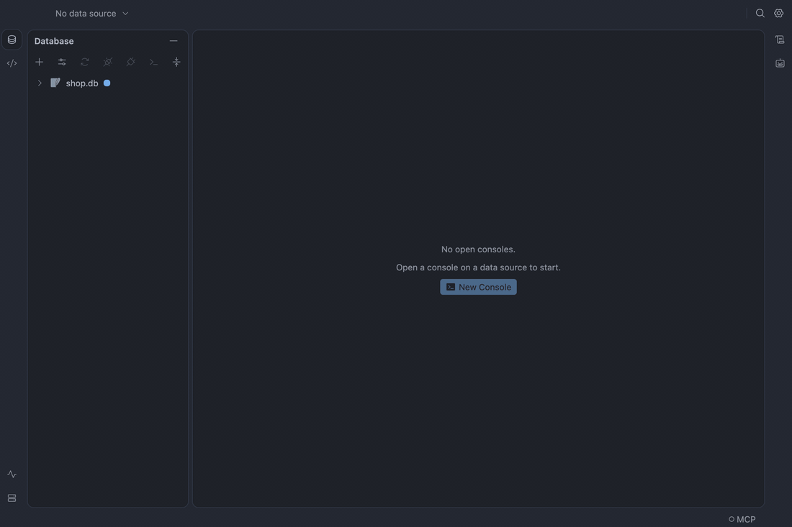

# Plugins

A plugin is a folder with a `table-craft-plugin.json` manifest and an ES module. The built-in
plugins ship inside the app, others TableCraft offers
[download on demand](#databases-in-the-box-and-on-demand); your own go in `plugins/<id>/` in the
[profile folder](data-and-privacy.md) and load the same way. A plugin that fails to load is
listed as unavailable with the reason; the app keeps running.

## Databases in the box and on demand

SQLite and MySQL (with MariaDB and TiDB) ship inside the app and work offline from the first
launch. PostgreSQL is a plugin TableCraft downloads when you need it, about 190 KB, from npm as
[`@tablecraft-app/plugin-postgres`](https://www.npmjs.com/package/@tablecraft-app/plugin-postgres).
Redis downloads the same way, about 290 KB, as
[`@tablecraft-app/plugin-redis`](https://www.npmjs.com/package/@tablecraft-app/plugin-redis),
Oracle, about 360 KB, as
[`@tablecraft-app/plugin-oracle`](https://www.npmjs.com/package/@tablecraft-app/plugin-oracle), and
SQL Server (2017 and later, and Azure SQL), about 760 KB, as
[`@tablecraft-app/plugin-mssql`](https://www.npmjs.com/package/@tablecraft-app/plugin-mssql), and
etcd (3.5 and later), about 400 KB, as
[`@tablecraft-app/plugin-etcd`](https://www.npmjs.com/package/@tablecraft-app/plugin-etcd)
(see [etcd](etcd.md)), and DuckDB, about 29 MB because it carries DuckDB itself, as
`@tablecraft-app/plugin-duckdb` followed by the system, such as
[`@tablecraft-app/plugin-duckdb-darwin-arm64`](https://www.npmjs.com/package/@tablecraft-app/plugin-duckdb-darwin-arm64)
(see [DuckDB](duckdb.md); macOS, Windows and Linux on x64 and arm64)
([decision 108](../decisions/108-sqlite-and-mysql-ship-other-plugins-download.md),
[decision 156](../decisions/156-native-drivers-ship-one-package-per-platform.md)).

- **Data Sources +** lists PostgreSQL, Redis, Oracle, SQL Server, etcd and DuckDB with **Download**. Choosing it
  shows the progress, then the connection form.
- A saved data source whose plugin is missing shows greyed in the Database pane with **Install**.
  After an update from a version that had PostgreSQL built in, TableCraft installs it in the
  background on the first start, with no question.
- A downloaded plugin built for an older plugin API than this TableCraft cannot run, so it is
  treated as missing: TableCraft downloads the build for this version as soon as it starts, even
  with automatic checks off, and the data source shows **Updating…**. Connecting waits for it. If
  the download fails, the data source shows **Update failed** with **Retry**, and connecting says
  the plugin must be updated. A plugin you built or installed from a file is left alone and listed
  as unavailable until you rebuild it.
- A plugin built for a newer plugin API shows **Needs a newer TableCraft**, with **Check for
  Updates**.
- **Settings → Plugins** lists the built-in plugins, the downloaded ones with their version,
  **Update** and **Remove** (refused while a data source uses the plugin, naming it), and your
  own. With **Check for updates automatically** on, downloaded plugins are checked every 2 hours and
  a newer compatible version is used from the next connection.
- Offline, or behind a firewall: every release attaches the plugin `.tgz` files. Choose **Install
  from File…** in Settings → Plugins; TableCraft asks before installing any file, and refuses a
  DuckDB file built for another system, naming the one to pick.
- Behind a corporate npm mirror, set its address in Settings → Plugins (`plugins.registryUrl`).

TableCraft installs the newest release its plugin API accepts (a beta too, with **Get beta
versions** checked in Settings → Advanced), refuses a download whose sha512
does not match the registry's, and keeps each version in `managed-plugins/` in the profile folder
([decision 110](../decisions/110-the-app-installs-plugins-from-the-registry.md)).

To write a plugin of your own, see [Writing plugins](writing-plugins.md).
