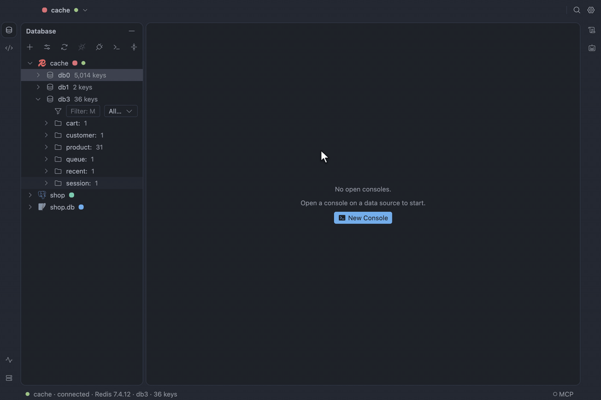
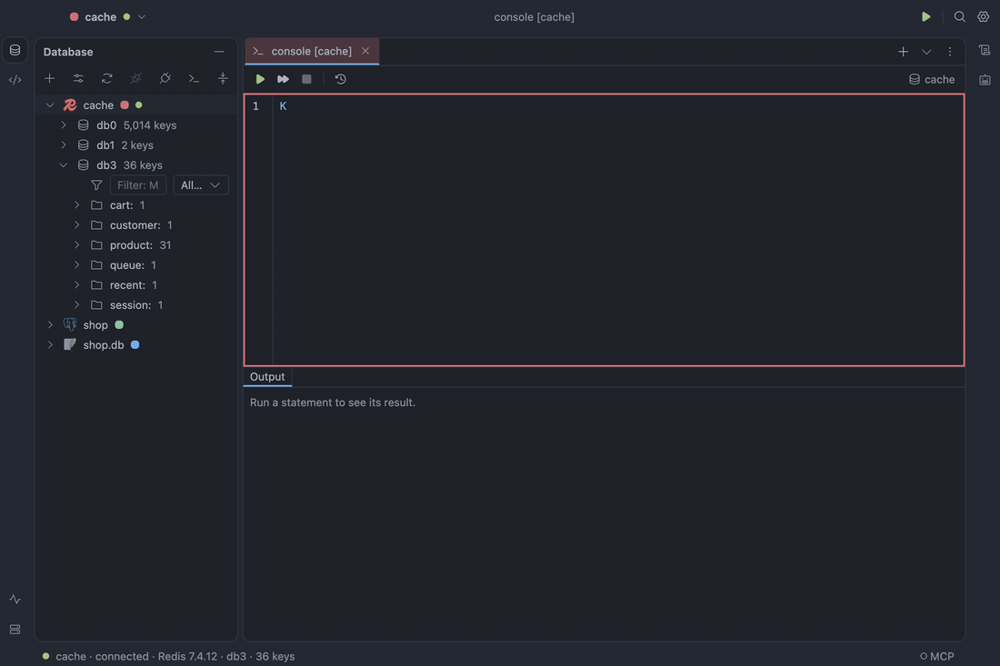

# Redis

The Redis plugin connects to Redis 5.0 or later, **Standalone** or **Cluster** (pick the Mode in the
connection form; a `redis://` or `rediss://` URL fills a standalone one). A cluster is reached from
its seed node; when its nodes announce addresses you cannot reach, map each one in **Node address
map** (`10.0.1.5:6379=127.0.0.1:7001, …`). A cluster cannot go through an SSH tunnel. Redis 5.0
has no ACL users: leave Username empty and give the password alone.

- **Key tree.** Each database lists its keys in folders by `:`, with a type badge and TTL. The tree
  scans 10,000 keys at a time behind a **Load more** row, never with `KEYS`; the filter row takes a
  `MATCH` pattern and a type. **Go to Key…** opens a key by name, and Search Everywhere has a Keys
  tab.
- **Key tabs.** A hash, list, set, sorted set or stream opens in the result grid with its own
  columns; a string opens in a value editor that reads it as Text, JSON, Hex, Base64, MessagePack or
  gzip. The header counts the TTL down and shows length, memory and encoding. Edit cells, add and
  delete rows, preview the commands, and submit them as one `MULTI`; if another client changed the
  key since you read it, you choose to reload or overwrite.
- **Key actions.** New Key…, Rename, Delete, Set TTL…, Remove TTL and Delete Keys Under Folder…
  (a cancellable task in Services).
- **Console.** One command per line with `redis-cli` quoting. Completion and signature help come
  from the server's command docs, and key names complete from a scan. `FLUSHDB` and `FLUSHALL` ask
  you to type the data source's name; `KEYS` and other heavy reads are underlined, with a fix such as
  **Use SCAN**. In a cluster, **Run on** sends a command to one node or every primary.
- **Console results.** A value read (`GET`, `HGET`, `LINDEX`…) opens a one-row `value` tab as well
  as its Output line; a number or status stays in Output, where **Show as Result** opens it as a
  tab. The value panel reads a result's values as the key tab does, Auto first (JSON, gzip,
  MessagePack…), and remembers your format per key pattern. When a result reads one key, **Open
  Key** (`⌘B`) opens it in a key tab. A result that reads a whole key (`GET`, `HGETALL`,
  `SMEMBERS`, `LRANGE key 0 -1`, `ZRANGE key 0 -1 WITHSCORES`) takes edits with the key tab's
  columns and submits them as one guarded `MULTI`; other results say why they are read-only.
- **Server tab.** `INFO` as cards with auto-refresh, every node of a cluster at a glance, and the
  slow log. **Show Sessions…** lists `CLIENT LIST` and unblocks or kills a client.

See [Command consoles](../design/specification.md#command-consoles),
[Key browser](../design/specification.md#key-browser) and
[Server tab](../design/specification.md#server-tab).
