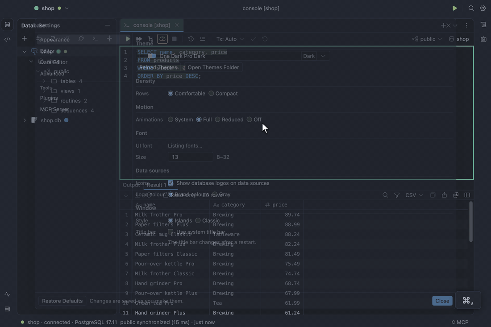

# Settings and appearance

**Settings…** (`⌘,`) has pages for Appearance, Editor, Data Editor and Advanced. The theme is a
dropdown: type to filter by name or source, and the theme under the arrow keys or the mouse
previews live; Enter or a click keeps it, Escape puts the previous one back. Themes and density
change live; Follow system picks Dark, Light or High contrast from the operating system. `⌘=`, `⌘-` and
`⌘0` zoom the editor font. Menus, popovers and dialogs fade in briefly and close at once; **Motion**
turns that down to Reduced or Off, or follows the operating system's Reduce Motion (System).



See [Settings and appearance](../design/specification.md#settings-and-appearance).

## Settings file

Settings live in `settings.json` in your [profile folder](data-and-privacy.md). The Settings
dialog writes it; you can also edit it by hand, and a field that is missing or out of range falls
back to its default without affecting the others.

| Field                                  | Values                                                                                          | Default                                        |
| :------------------------------------- | :---------------------------------------------------------------------------------------------- | :--------------------------------------------- |
| `appearance.theme`                     | `system`, `dark`, `light`, `highContrast`, an id from [Themes](themes.md), `user:<file stem>`   | `system`                                       |
| `appearance.density`                   | `comfortable`, `compact`                                                                        | `comfortable`                                  |
| `appearance.motion`                    | `system`, `full`, `reduced`, `off`                                                              | `system`                                       |
| `appearance.systemTitleBar`            | `true`, `false`; read when the window opens                                                     | `false`                                        |
| `appearance.brandIcons`                | `true`, `false`; database logos on data sources                                                 | `true`                                         |
| `appearance.brandIconColor`            | `brand`, `gray`; the logos' colour                                                              | `brand`                                        |
| `appearance.fonts.ui`                  | `family`: a font name, or `null` for the built-in; `sizePx`: 8–32                               | `null`, 13                                     |
| `appearance.fonts.editor`              | `family`: a font name, or `null` for the built-in; `sizePx`: 8–32                               | `null`, 13                                     |
| `appearance.fonts.grid`                | `family`: a font name, or `null` for the built-in; `sizePx`: 8–32                               | `null`, 12                                     |
| `editor.format.style`                  | `aligned`, `standard`; how Reformat Code lays SQL out                                           | `aligned`                                      |
| `editor.format.keywordCase`            | `upper`, `lower`, `preserve`; how Reformat Code cases keywords                                  | `upper`                                        |
| `editor.format.indentWidth`            | 1–8 spaces                                                                                      | 2                                              |
| `editor.format.linesBetweenStatements` | 0–5 blank lines                                                                                 | 1                                              |
| `editor.format.alignAliases`           | `true`, `false`; line up `AS` in a select list (aligned style)                                  | `true`                                         |
| `editor.inspections.enabled`           | `true`, `false`; check SQL as you type                                                          | `true`                                         |
| `editor.inspections.disabled`          | inspection ids to skip, such as `SqlRedundantAlias`                                             | `[]`                                           |
| `console.parameters`                   | `true`, `false`; ask for `:name`, `?` and `$1` values before a run                              | `true`                                         |
| `console.statementTimeoutSeconds`      | 0–86,400; a console statement running longer is cancelled; 0 waits                              | 0                                              |
| `console.sessionsRefreshSeconds`       | 1–3,600; how often a Sessions tab with Auto-refresh on lists again                              | 5                                              |
| `console.runAllOnError`                | `ask`, `stop`, `continue`; what a run of several statements or a SQL script does on a failure   | `ask`                                          |
| `data.nullText`                        | 1–16 characters                                                                                 | `<null>`                                       |
| `data.groupDigits`                     | `true`, `false`                                                                                 | `false`                                        |
| `data.detectJson`                      | `true`, `false`; open a text value holding a JSON object or array formatted in the value panel  | `true`                                         |
| `data.pageRows`                        | 10–10,000                                                                                       | 500                                            |
| `data.fetchAllCap`                     | 1,000–1,000,000, at least `pageRows`                                                            | 100,000                                        |
| `data.aggregates`                      | which of `count`, `distinct`, `sum`, `avg`, `min`, `max` the grid's selection line shows        | `["count","distinct","sum","avg","min","max"]` |
| `data.blobLimitMb`                     | 1–128; the largest file, in MiB, Load from File puts into a binary cell, and Save to File reads | 16                                             |
| `log.level`                            | `info`, `debug`                                                                                 | `info`                                         |
| `data.exportStallSeconds`              | 10–3,600; an export or import the database stalls this long fails                               | 120                                            |
| `data.watchRetention`                  | 1,000–100,000; events retained per new watch                                                    | 10,000                                         |
| `updates.checkAutomatically`           | `true`, `false`; look for a new version after launch and daily                                  | `true`                                         |
| `updates.channel`                      | `auto`, `stable`, `beta`; `auto` follows the build you run. Plugins follow it too               | `auto`                                         |
| `plugins.registryUrl`                  | an `https://` npm registry (plain `http://` only on this machine); where plugins download from  | `https://registry.npmjs.org`                   |
| `mcp.clients`                          | `{ "name", "allowed" }` per MCP client you answered; [Allow or Block](agents.md)                | `[]`                                           |
| `mcp.enabled`                          | `true`, `false`; run the [MCP server](agents.md) for AI agents                                  | `false`                                        |
| `mcp.port`                             | 1,024–65,535; the port it listens on, on 127.0.0.1 only                                         | 47,820                                         |
| `mcp.rowCap`                           | 1–1,000; the most rows one agent answer carries                                                 | 100                                            |
| `mcp.statementTimeoutSeconds`          | 1–3,600; an agent's statement running longer is stopped, by the database too where it can       | 120                                            |

A theme of your own is a JSON file in `themes/` in the profile folder. It names any bundled theme,
by its id from [Themes](themes.md), as its base and overrides any of its colour tokens; it then
appears as `user:<file stem>`, here `user:solarized`:

```json
{
  "name": "Solarized Dark",
  "base": "dark",
  "colors": {
    "canvas": "#002b36",
    "panel": "#073642"
  }
}
```

A file that does not parse, or whose base is not a bundled theme, is listed under Your themes,
disabled, with its errors. **Reload Themes** in the Settings dialog picks up new or changed files.
