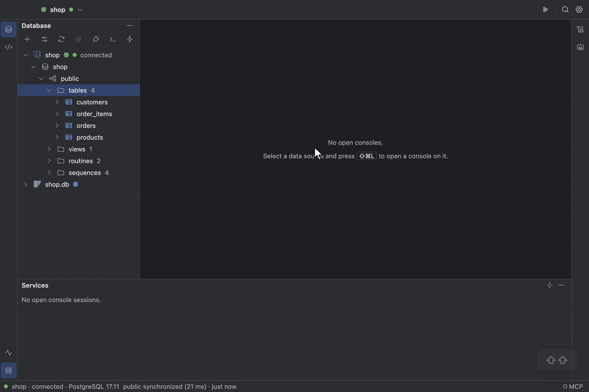

# Search Everywhere and shortcuts

TableCraft follows DataGrip's keymap, and every command can also be found by name.

## Search Everywhere

Press `⇧⇧` to search tables and actions together, or `Tab` to the **Tables** or **Actions** tab;
`↩` on a table opens its data. **Find Action** (`⇧⌘A`) lists every command with its shortcut, so
nothing is only reachable by a chord.

See [Shell and actions](../design/specification.md#shell-and-actions).

## Keyboard shortcuts

| Action                    | macOS   | Windows / Linux        |
| :------------------------ | :------ | :--------------------- |
| Run                       | `⌘↩`    | `Ctrl+Enter`           |
| Run All                   | `⇧⌘↩`   | `Ctrl+Shift+Enter`     |
| Explain Plan              | `⇧⌘E`   | `Ctrl+Shift+E`         |
| Next Error                | `F2`    | `F2`                   |
| Previous Error            | `⇧F2`   | `Shift+F2`             |
| Show Context Actions      | `⌥↩`    | `Alt+Enter`            |
| Commit                    | `⌥⇧⌘↩`  | `Ctrl+Alt+Shift+Enter` |
| Reformat Code             | `⌥⌘L`   | `Ctrl+Alt+L`           |
| New Console               | `⇧⌘L`   | `Ctrl+Shift+L`         |
| Open File…                | `⌘O`    | `Ctrl+O`               |
| Save                      | `⌘S`    | `Ctrl+S`               |
| Save As…                  | `⇧⌘S`   | `Ctrl+Shift+S`         |
| Close Tab                 | `⌘W`    | `Ctrl+W`               |
| Reopen Closed Tab         | `⇧⌘T`   | `Ctrl+Shift+T`         |
| Select Next Tab           | `⇧⌘]`   | `Ctrl+Shift+]`         |
| Select Previous Tab       | `⇧⌘[`   | `Ctrl+Shift+[`         |
| Database                  | `⌘1`    | `Ctrl+1`               |
| Services                  | `⌘8`    | `Ctrl+8`               |
| Hide All Tool Windows     | `⇧⌘F12` | `Ctrl+Shift+F12`       |
| Search Everywhere         | `⇧⇧`    | `Double Shift`         |
| Find Action…              | `⇧⌘A`   | `Ctrl+Shift+A`         |
| New Data Source…          | `⌘N`    | `Ctrl+N`               |
| Data Source Properties…   | `⌘;`    | `Ctrl+;`               |
| Disconnect                | `⌘F2`   | `Ctrl+F2`              |
| Move Up                   | `⌥⇧↑`   | `Alt+Shift+ArrowUp`    |
| Move Down                 | `⌥⇧↓`   | `Alt+Shift+ArrowDown`  |
| Synchronize               | `⌥⌘Y`   | `Ctrl+Alt+Y`           |
| Modify Table…             | `⌘F6`   | `Ctrl+F6`              |
| Rename…                   | `⇧F6`   | `Shift+F6`             |
| Drop…                     | `⌘⌫`    | `Ctrl+Backspace`       |
| Go to DDL                 | `⌘B`    | `Ctrl+B`               |
| Go to Declaration         | `⌘B`    | `Ctrl+B`               |
| Open Key                  | `⌘B`    | `Ctrl+B`               |
| Parameter Info            | `⌘P`    | `Ctrl+P`               |
| Quick Documentation       | `F1`    | `F1`                   |
| Open Data                 | `F4`    | `F4`                   |
| SQL Generator…            | `⌥⌘G`   | `Ctrl+Alt+G`           |
| Query History…            | `⌥⌘E`   | `Ctrl+Alt+E`           |
| Preview Pending Changes   | `⇧⌘P`   | `Ctrl+Shift+P`         |
| Submit                    | `⌘↩`    | `Ctrl+Enter`           |
| Find in Console           | `⌘F`    | `Ctrl+F`               |
| Replace in Console        | `⌘R`    | `Ctrl+R`               |
| Find Next Occurrence      | `⌘G`    | `Ctrl+G`               |
| Find Previous Occurrence  | `⇧⌘G`   | `Ctrl+Shift+G`         |
| Replace All               | `⌥⌘↩`   | `Ctrl+Alt+Enter`       |
| Select All Occurrences    | `⌥⇧⌘J`  | `Ctrl+Alt+Shift+J`     |
| Find in Result            | `⌘F`    | `Ctrl+F`               |
| Transpose                 | `⌥⌘T`   | `Ctrl+Alt+T`           |
| Toggle JSON View          | `⌥⌘J`   | `Ctrl+Alt+J`           |
| Toggle Boolean            | `Space` | `Space`                |
| Settings…                 | `⌘,`    | `Ctrl+,`               |
| Increase Editor Font Size | `⌘=`    | `Ctrl+=`               |
| Decrease Editor Font Size | `⌘-`    | `Ctrl+-`               |
| Reset Editor Font Size    | `⌘0`    | `Ctrl+0`               |

Find Action (`⇧⌘A`) lists every action with its shortcut; the specification's
[action table](../design/specification.md#shell-and-actions) has the full keymap.
